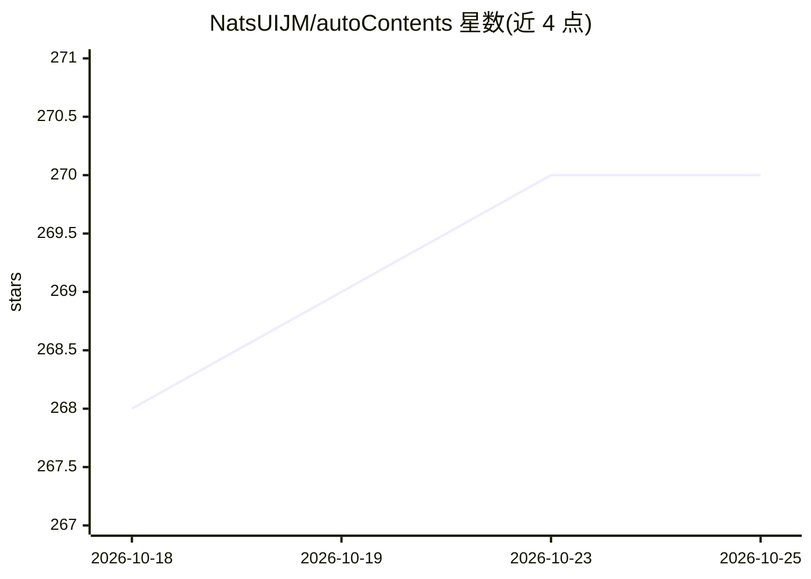

# NatsUIJM/autoContents

⭐ 270 · Python · NOASSERTION · 推送 2026-10-05 · [GitHub](https://github.com/NatsUIJM/autoContents) · 个人维护 · 中文 README

**为扫描版 PDF 自动生成可跳转书签的视觉 LLM 工具**

面向扫描版 PDF 的书签生成工具：上传带目录页的中英文 PDF，工具用视觉/多模态 LLM（任意 OpenAI 兼容服务商，如通义千问、书生·浦语、OpenAI、DeepSeek）识别目录页图片，自动生成并写入可跳转书签，约 1 分钟出结果。支持罗马数字页码与前言偏移计算、拖拽上传、PDF 完整性预检。以网页 UI（Flask 本地启动）形式提供，Releases 压包无需安装 Python；另附 CSV 书签编辑脚本与可选 MCP 服务器模式，供 Claude Desktop 等 AI 客户端调用。注意：采用专有许可（source-available），商业使用需书面授权；需自备 LLM API Key。

## 筛选速览

| 维度 | 判定 | 备注 |
|---|---|---|
| AI 角色 | `ai-native` | 本体是模型或模型工具 |
| 许可风险 | `none` | NOASSERTION |
| 部署形态 | `desktop` | 安装包/桌面程序 |
| 模型依赖 | locked-api |  |
| 硬件要求 | — | 无带数字的原话,不猜 |
| 安装摩擦 | `low` | 无编译、无系统依赖或容器化 |
| 成熟度 | — | 结构信号不足 |

## 能力要点

- 任意 OpenAI 兼容视觉/多模态 LLM 服务商均可接入
- 罗马数字页码识别与前言偏移自动计算
- CSV 书签提取/编辑/合并脚本
- 可作为 MCP 服务器被 AI 编程助手调用

## 适用场景

- 给扫描版书籍/资料 PDF 批量添加可跳转目录书签
- 识别前言罗马数字页码并正确排序目录
- 让 Claude Desktop 等 AI 客户端直接调用书签生成能力

## 场景标签

`文档解析` · 领域:知识与检索

## 证据(README 行号)

> L5: autoContents 是一款专为扫描版 PDF 设计的书签全自动生成工具，能够基于目录页内容创建可跳转书签。上传 PDF 文档后无需进行任何其他操作，等待 1 分钟左右即可获取处理结果。
> L62: 本工具需要使用支持**视觉/多模态**的 LLM 模型来识别 PDF 目录页图片。你可以选择任意 OpenAI 兼容的 LLM 服务商。
> L26: - **支持任意 OpenAI 兼容的 LLM 服务商**（通义千问、书生·浦语、OpenAI、DeepSeek 等），不再局限于通义千问

## 星数曲线

2026-10-18 268 → 2026-10-25 270（+2）

---
*卡片 v1 · prompt 1.4 · 生成 2026-10-22 · 置信度 mid · 依据 README sha `bb16ff93770b` · [字段定义](../../DATASET.md)*
