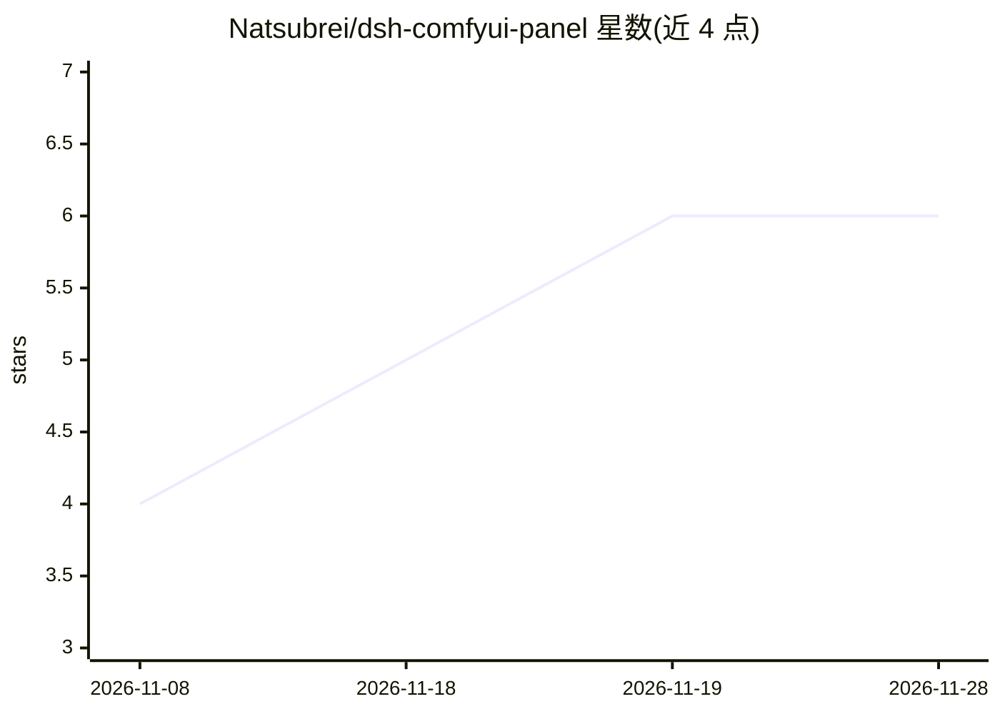

# Natsubrei/dsh-comfyui-panel

⭐ 6 · JavaScript · MIT · 推送 2026-11-18 · [GitHub](https://github.com/Natsubrei/dsh-comfyui-panel) · 个人维护 · 中文 README

**在 DeepSeek Harness Web UI 中嵌入 ComfyUI 编辑器，模型可读写运行工作流**

一个 DSH 插件，把 ComfyUI 前端作为独立页面挂进 DeepSeek Harness Web UI，不内置、不 fork ComfyUI，复用本机已安装的服务。画布旁的对话列让模型通过 `comfyui_*` 系列工具读取图结构、按批次增删重连节点、改控件值、发起运行并取回 PNG 输出；工作流按会话持久化到 `dsh_comfyui` 域，Host 重启不丢失。面板可代管 ComfyUI 进程的启动与停止。需要本机已有可应答的 ComfyUI 服务，默认上游 `127.0.0.1:8188`。

## 筛选速览

| 维度 | 判定 | 备注 |
|---|---|---|
| AI 角色 | `ai-native` | 本体是模型或模型工具 |
| 许可风险 | `permissive` | MIT |
| 部署形态 | `desktop` | 安装包/桌面程序 |
| 模型依赖 | — | README 未给出锁定关系 |
| 硬件要求 | — | 无带数字的原话,不猜 |
| 安装摩擦 | `low` | 无编译、无系统依赖或容器化 |
| 成熟度 | — | 结构信号不足 |

## 能力要点

- 模型工具覆盖图读取、批量编辑、运行、取消、进度与工作流存取等操作
- UI 工作流作为权威图，编辑器事件经 ComfyUI 自身 socket 转发
- 会话与工作流持久化存储，保留最近 20 个会话
- 通过插件市场索引或 `dsh` CLI 安装，可从面板启动/停止 ComfyUI 进程

## 适用场景

- 在对话中让模型修改并运行 ComfyUI 工作流生成图片
- 把已有的本机 ComfyUI 接入 DSH 的 Agent 会话
- 统一管理 ComfyUI 服务的启动、停止与随 DSH 启动

## 场景标签

`图像生成` · 领域:内容生成

## 证据(README 行号)

> L13: **把 ComfyUI 编辑器作为独立的一页放进 DeepSeek Harness Web UI，画布旁的对话列让模型读取、编辑并运行这张工作流。**
> L18: - **模型能改图** — `comfyui_*` 工具读取图、按批次增删和重连节点、改控件值、发起运行、取回输出。UI 工作流始终是权威图。

## 星数曲线

2026-11-08 4 → 2026-11-28 6（+2）

---
*卡片 v1 · prompt 1.4 · 生成 2026-11-20 · 置信度 mid · 依据 README sha `05f7294f465e` · [字段定义](../../DATASET.md)*
