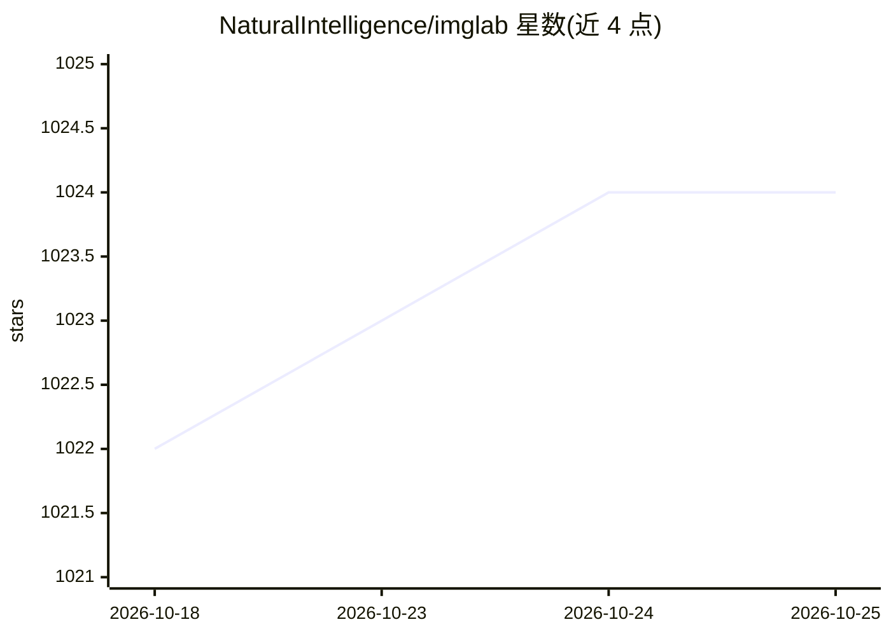

# NaturalIntelligence/imglab

⭐ 1,024 · HTML · MIT · 推送 2026-08-18 · [GitHub](https://github.com/NaturalIntelligence/imglab) · [官网](https://solothought.com/imglab/) · 个人维护

**浏览器端图像标注工具，产出 dlib/COCO 等训练数据格式**

基于 Web 的图像标注工具，用于为 dlib 或其他目标检测器生成训练数据。平台无关，直接在浏览器运行，无前置依赖，CPU 与内存占用低。支持绘制特征点、矩形、多边形等形状，支持 dlib XML、dlib pts、Pascal VOC、COCO 多种导出格式（Tensorflow 格式在计划中），并提供插件（Face++）、自动建议、快捷键、浏览器缓存自动保存等功能。项目文件采用 Nimn 数据格式，体积小便于分享。README 声明项目正在寻找维护者。

## 筛选速览

| 维度 | 判定 | 备注 |
|---|---|---|
| AI 角色 | `ai-ecosystem` | LLM/agent 周边工具 |
| 许可风险 | `permissive` | MIT |
| 部署形态 | `None` |  |
| 模型依赖 | — | README 未给出锁定关系 |
| 硬件要求 | — | 无带数字的原话,不猜 |
| 安装摩擦 | `low` | 无编译、无系统依赖或容器化 |
| 成熟度 | — | 结构信号不足 |

## 能力要点

- 浏览器直接运行，无前置依赖，平台无关
- 支持 dlib XML/pts、Pascal VOC、COCO 等多格式导出
- 特征点/关键点顺序可通过拖拽调整，面向 dlib 用户
- 插件机制（如 Face++）与自动建议功能

## 适用场景

- 为 dlib 目标检测器标注训练图像与特征点
- 将标注结果导出为 COCO/Pascal VOC 等通用格式用于模型训练
- 小团队通过邮件分享轻量的项目标注文件

## 场景标签

 · 领域:计算机视觉/数据标注

## 证据(README 行号)

> L5: A web based tool to label images for objects that can be used to train dlib or other object detectors.
> L25: ImgLab is platform independent, runs directly from the browser, and has no prerequisites. It requires minimal CPU a

## 星数曲线

2026-10-18 1,022 → 2026-10-25 1,024（+2）

---
*卡片 v1 · prompt 1.4 · 生成 2026-10-21 · 置信度 high · 依据 README sha `015b2a84cb20` · [字段定义](../../DATASET.md)*
