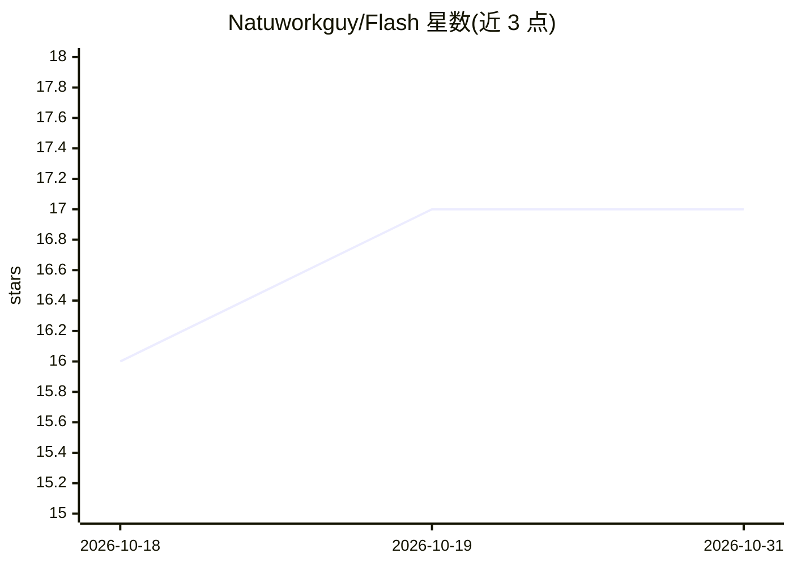

# Natuworkguy/Flash

⭐ 17 · Python · MIT · 推送 2026-10-30 · [GitHub](https://github.com/Natuworkguy/Flash) · [官网](https://flashproject.dev) · 个人维护

**本地优先的终端 AI Agent 外壳：对话驱动执行命令与编辑文件**

FLASH（Fast Local Agent Shell）是一个命令行 AI agent 界面，通过本地或远程 Ollama 服务器与模型交互，支持 AI 执行 shell 命令、按行精确编辑文件、/undo 撤销、按模型上下文窗口管理历史并自动摘要压缩。附带能力包括图像识别、3D 模型生成（.glb）、无头浏览器页面截图与交互、Vosk/Piper 语音模式、后台子代理、VS Code 终端集成（diff 预览、命令失败上下文）。提供配套的 Flash Onyx 系列 Ollama 模型（Modelfile 构建）。面向使用本地模型的开发者，需自备 Ollama 服务器。

## 筛选速览

| 维度 | 判定 | 备注 |
|---|---|---|
| AI 角色 | `ai-native` | 本体是模型或模型工具 |
| 许可风险 | `permissive` | MIT |
| 部署形态 | `desktop` | 安装包/桌面程序 |
| 模型依赖 | local-ok | 支持本地模型 |
| 硬件要求 | — | 无带数字的原话,不猜 |
| 安装摩擦 | `low` | 无编译、无系统依赖或容器化 |
| 成熟度 | — | 结构信号不足 |

## 能力要点

- 按行精确文件编辑与 /undo 整轮撤销
- 按模型真实上下文窗口管理历史并在溢出时自动摘要
- 无头浏览器页面截图与点击/填表/执行 JS 的页面调试
- 后台子代理并行处理独立子任务并自动唤醒汇报
- Vosk/Piper 语音模式与 VS Code 终端 hook 集成

## 适用场景

- 在终端通过对话让 AI 执行命令、修改代码并逐行审查 diff
- 用本地 Ollama 模型做无需外部 API 的编码辅助
- 让子代理并行拆解多步任务并汇总结果

## 场景标签

`编码 Agent` `浏览器自动化` · 领域:效率与自动化

## 证据(README 行号)

> L3: FLASH (**F**ast **L**ocal **A**gent **SH**ell) CLI is an AI-powered command-line interface that allows you to intera
> L15:  - AI can use a `shell` tool to execute commands and see their output.
> L22: - **Voice Mode**: `/voice on` downloads a Vosk speech model and a Piper voice, then lets you talk to Flash and hear

## 星数曲线

2026-10-18 16 → 2026-10-31 17（+1）

---
*卡片 v1 · prompt 1.4 · 生成 2026-10-30 · 置信度 mid · 依据 README sha `9d02a38d1dcc` · [字段定义](../../DATASET.md)*
