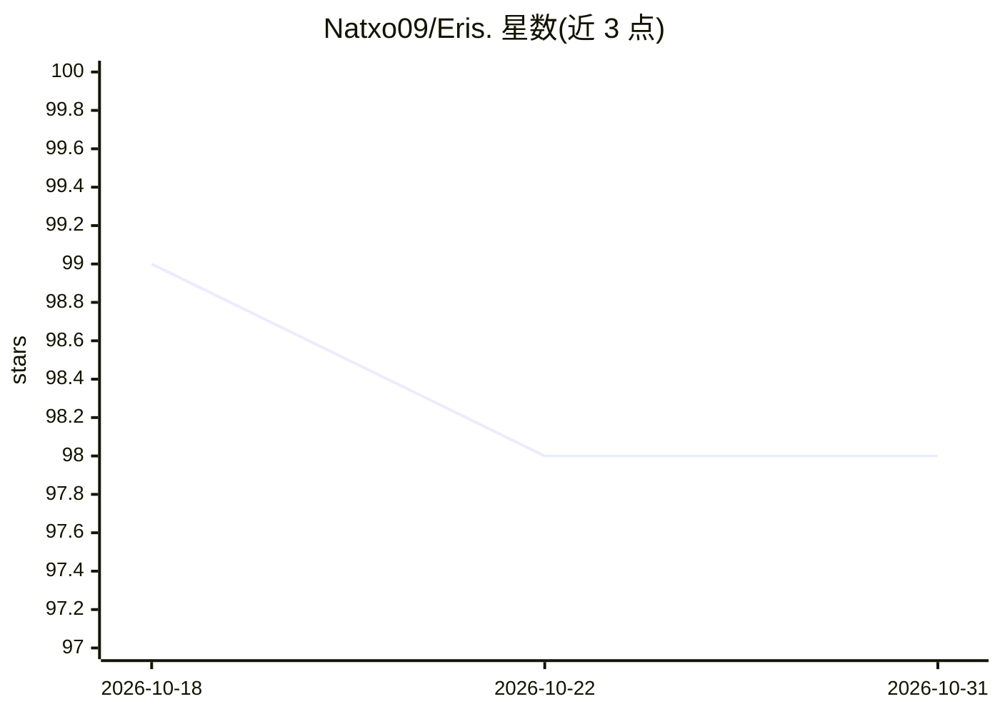

# Natxo09/Eris.

⭐ 98 · Swift · MIT · 推送 2026-06-23 · [GitHub](https://github.com/Natxo09/Eris.) · [官网](https://eris.natxo.dev) · 个人维护

**iPhone/iPad 上完全离线运行的私有 AI 聊天应用**

基于 Apple MLX 框架与 SwiftUI 构建的 iOS/iPadOS 本地 AI 聊天应用：模型下载后全程在设备端运行，对话数据以 SwiftData 本地存储，无遥测、除模型下载外无网络请求。支持 Llama 3.2、Qwen 2.5、Gemma 2、Phi 3.5 Mini、DeepSeek-R1-Distill 等量化模型（4/8-bit），并提供 Apple Shortcuts 集成（快速问答、摘要、12+ 语言翻译、文本生成）。需 A13 及以上芯片 iPhone 或 M1 及以上 iPad，开发构建需 Apple Silicon Mac 与 Xcode 15+，iOS 模拟器不可用。

## 筛选速览

| 维度 | 判定 | 备注 |
|---|---|---|
| AI 角色 | `ai-native` | 本体是模型或模型工具 |
| 许可风险 | `permissive` | MIT |
| 部署形态 | `None` |  |
| 模型依赖 | locked-api |  |
| 硬件要求 | — | 无带数字的原话,不猜 |
| 安装摩擦 | `low` | 无编译、无系统依赖或容器化 |
| 成熟度 | — | 结构信号不足 |

## 能力要点

- MLX 框架驱动的设备端推理，离线可用
- 支持 Llama/Qwen/Gemma/Phi/DeepSeek-R1-Distill 量化模型
- Apple Shortcuts 集成：问答、摘要、翻译、文本生成
- 本地 SwiftData 存储，无遥测，支持全量数据删除

## 适用场景

- 在没有网络的场景下用 iPhone/iPad 与 AI 对话
- 通过 Siri 快捷指令做摘要、翻译和内容生成
- 在设备本地保留全部对话数据，不依赖云端

## 场景标签

`聊天机器人` `AI 助手` · 领域:对话与助手

## 证据(README 行号)

> L13: Eris is a private AI chat application that runs entirely on your device using Apple's MLX framework. Named after th
> L18: - 🚀 **Blazing Fast** - Powered by Apple Silicon and MLX
> L20: - 🤖 **Multiple Models** - Support for Llama, Qwen, DeepSeek, and more

## 星数曲线

2026-10-18 99 → 2026-10-31 98（-1）

---
*卡片 v1 · prompt 1.4 · 生成 2026-10-23 · 置信度 high · 依据 README sha `a03d888bbd61` · [字段定义](../../DATASET.md)*
