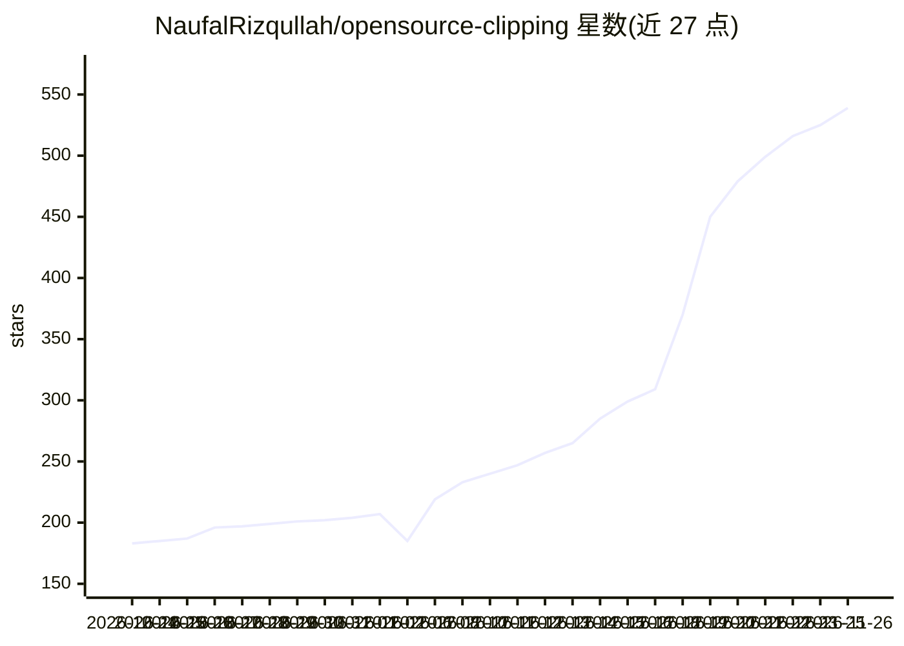

# NaufalRizqullah/opensource-clipping

⭐ 539 · Python · MIT · 推送 2026-11-25 · [GitHub](https://github.com/NaufalRizqullah/opensource-clipping) · [官网](https://naufalrizqullah.github.io/opensource-clipping/) · 个人维护

**把长视频/播客自动剪成短视频的开源 AI 工具**

开源的 AI 自动剪辑流水线，提供 CLI、Web Studio（GitHub Pages 前端 + Kaggle/Colab FastAPI 后端）与 Colab/Kaggle notebook 三种使用方式。功能包括 Faster-Whisper 词级转写、Gemini/NVIDIA NIM/vLLM 分析选段与生成元数据、MediaPipe 人脸追踪自动取景、卡拉OK字幕、B-roll、配音、自动缩略图，以及 YouTube/Facebook 定时上传。依赖 Python 3.10+、FFmpeg，推荐 CUDA GPU，无 GPU 可用 Colab。

## 筛选速览

| 维度 | 判定 | 备注 |
|---|---|---|
| AI 角色 | `ai-native` | 本体是模型或模型工具 |
| 许可风险 | `permissive` | MIT |
| 部署形态 | `library` | 以包/库形式分发 |
| 模型依赖 | local-ok | 支持本地模型 |
| 硬件要求 | — | 无带数字的原话,不猜 |
| 安装摩擦 | `medium` | 含编译或系统依赖之一 |
| 成熟度 | — | 结构信号不足 |

## 能力要点

- Faster-Whisper (large-v3) 词级转写与 Pyannote 说话人分离分屏
- AI 内容策展支持 Gemini、NVIDIA NIM 或自托管 vLLM 三种提供方
- 人脸追踪自动取景、卡拉OK字幕、B-roll、AI 配音等剪辑功能
- Web Studio 通过 ngrok 隧道连接 Kaggle/Colab 后端进行 GUI 操作

## 适用场景

- 把长视频和播客批量剪成适合 Reels/Shorts 的短视频
- 无本地 GPU 时用 Colab/Kaggle 运行完整剪辑流水线
- 生成带卡拉OK字幕与钩子预告的营销短片并定时发布到 YouTube/Facebook

## 场景标签

`图像视频处理` · 领域:感知与多模态

## 证据(README 行号)

> L7:  Ultimate AI Auto-Clipper & Teaser Generator
> L22: |**AI Transcriber**|Word-level transcription using **Faster-Whisper** (large-v3)|
> L23: |**AI Content Curator**|**Google Gemini**, **NVIDIA NIM**, or self-hosted **vLLM** analyzes context, selects highli

## 星数曲线

2026-10-24 183 → 2026-11-26 539（+356）

---
*卡片 v1 · prompt 1.4 · 生成 2026-11-25 · 置信度 high · 依据 README sha `d39a857c4712` · [字段定义](../../DATASET.md)*
