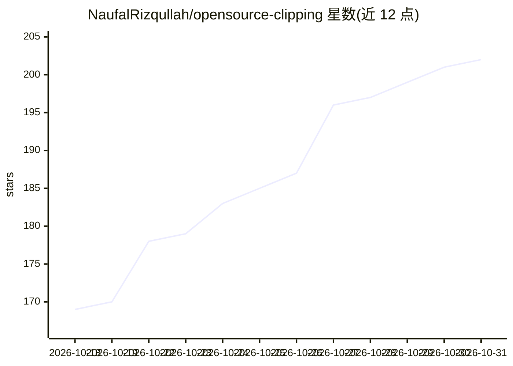

# NaufalRizqullah/opensource-clipping

⭐ 202 · Python · MIT · 推送 2026-09-26 · [GitHub](https://github.com/NaufalRizqullah/opensource-clipping) · [官网](https://naufalrizqullah.github.io/opensource-clipping/) · 个人维护 · 中文 README

**把长视频/播客自动转为短视频高光片段的 AI 剪辑流水线**

以 Python CLI 与 Colab/Kaggle notebook 形式提供的自动剪辑流水线：下载 YouTube/TikTok/Instagram 视频，用 Faster-Whisper 做词级转录，Google Gemini 选取高光片段并生成元数据，MediaPipe BlazeFace 做人脸跟踪自动构图，生成卡拉OK字幕、动态文字、B-roll、水印、缩略图，并可选自动上传 YouTube/Facebook。播客场景支持 Pyannote 说话人分离、分屏与镜头切换。必需 Python 3.10+、FFmpeg 与 Gemini API Key；CUDA GPU 为推荐项，可用 CPU 回退；另提供 GitHub Pages 网页 Studio 远程控制 Kaggle/Colab 后端。

## 筛选速览

| 维度 | 判定 | 备注 |
|---|---|---|
| AI 角色 | `ai-native` | 本体是模型或模型工具 |
| 许可风险 | `permissive` | MIT |
| 部署形态 | `library` | 以包/库形式分发 |
| 模型依赖 | — | README 未给出锁定关系 |
| 硬件要求 | — | 无带数字的原话,不猜 |
| 安装摩擦 | `medium` | 含编译或系统依赖之一 |
| 成熟度 | — | 结构信号不足 |

## 能力要点

- Faster-Whisper 词级转录 + Gemini 高光片段选取与元数据生成
- MediaPipe/YOLO 人脸跟踪自动构图与卡拉OK/动态字幕
- Pyannote 说话人分离驱动的播客分屏与镜头切换
- 可选自动上传 YouTube 与 Facebook Reels，含定时发布

## 适用场景

- 把长视频或播客批量剪成多条竖屏短视频
- 为播客自动生成分屏或跟随说话人的画面
- 生成带字幕、B-roll 与封面图的可发布短视频

## 场景标签

`图像视频处理` · 领域:感知与多模态

## 证据(README 行号)

> L22: |**AI Transcriber**|Word-level transcription using **Faster-Whisper** (large-v3)|
> L23: |**AI Content Curator**|**Google Gemini** analyzes context, picks the most viral moments, and generates metadata|

## 星数曲线

2026-10-18 169 → 2026-10-31 202（+33）

---
*卡片 v1 · prompt 1.4 · 生成 2026-10-22 · 置信度 mid · 依据 README sha `0677f30340a6` · [字段定义](../../DATASET.md)*
