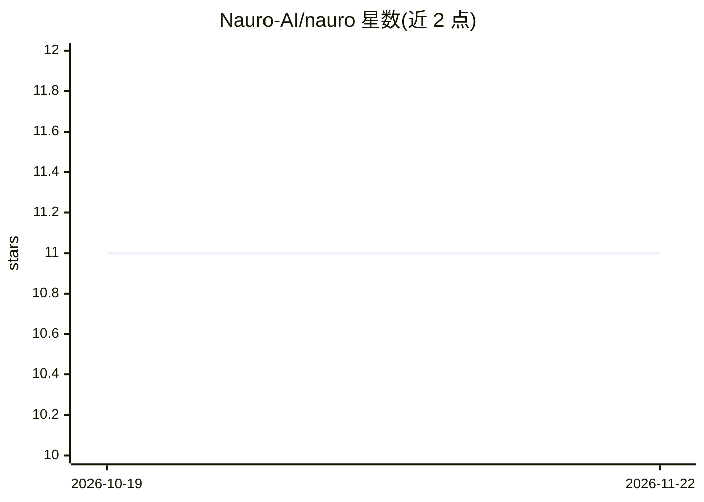

# Nauro-AI/nauro

⭐ 11 · Python · Apache-2.0 · 推送 2026-11-21 · [GitHub](https://github.com/Nauro-AI/nauro) · [官网](https://nauro.ai/decision-system) · 组织维护

**为 AI 辅助开发记录并复用项目决策的系统**

Nauro 记录开发者批准的项目决策及其理由与被否决的替代方案，并在后续 agent 会话中检索这些理由供参考。检索是咨询性质，新增或修改决策需开发者显式批准；记录以纯 Markdown 存于本地，本地使用无需账号，云同步为可选项且不发送产品分析数据。提供 macOS 桌面应用（含只读查看器）与 CLI，通过 MCP 接入 Claude Code、Codex、Cursor 等工具，附带 nauro-investigator 日志分析工具。

## 筛选速览

| 维度 | 判定 | 备注 |
|---|---|---|
| AI 角色 | `ai-ecosystem` | LLM/agent 周边工具 |
| 许可风险 | `permissive` | Apache-2.0 |
| 部署形态 | `library` | 以包/库形式分发 |
| 模型依赖 | — | README 未给出锁定关系 |
| 硬件要求 | — | 无带数字的原话,不猜 |
| 安装摩擦 | `low` | 无编译、无系统依赖或容器化 |
| 成熟度 | — | 结构信号不足 |

## 能力要点

- 记录已批准决策的理由与被否决方案，供后续 agent 会话检索
- 决策变更需显式批准，记录为本地纯 Markdown
- 通过 MCP 接入 Claude Code、Codex、Cursor
- 提供 macOS 桌面应用与 CLI 两种使用方式

## 适用场景

- 跨多个 agent 会话保持项目决策一致
- 团队交接时让新会话了解既往决策原因
- 审计 agent 是否遵循既定的项目决策

## 场景标签

`Agent 记忆` · 领域:Agent 开发

## 证据(README 行号)

> L3:  Decision system for software built with AI
> L74: Skip this command if the desktop wizard already adopted your repository. Restart your agent, then run `/nauro-adopt
> L88: Documentation covers commands, storage, and cloud access. Semantic versioning covers the CLI, local stdio MCP contr

## 星数曲线

2026-10-19 11 → 2026-11-22 11（+0）

---
*卡片 v1 · prompt 1.4 · 生成 2026-11-19 · 置信度 high · 依据 README sha `16d04411cbd2` · [字段定义](../../DATASET.md)*
