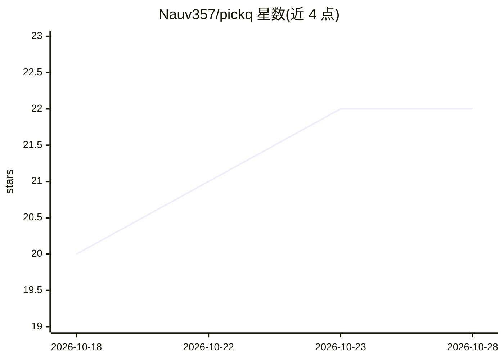

# Nauv357/pickq

⭐ 23 · Java · MIT · 推送 2026-09-16 · [GitHub](https://github.com/Nauv357/pickq) · [官网](https://pickq.cn/) · 个人维护 · 中文 README

**把试卷与笔记变成本机题库并间隔复习的 Windows 桌面应用**

面向备考与自学人群的 Windows 桌面应用：上传 PDF/Word/图片等学习材料，由用户自带 API Key 的模型（DeepSeek/通义/Kimi 或本地 Ollama）整理成单选、多选、判断、主观题等题库，逐题校对后刷题；带图资料的图片全程保留。做题记录、错题与间隔复习安排存储在本机（H2 文件库，数据目录 ~/.tiku），题库可导出为 .tiku/.json 普通文件分享或发布到题库广场。技术栈为 Tauri 2 壳 + Spring Boot 3 后端 + Vue 3 前端，自带裁剪 JRE，无需用户安装 Java。

## 筛选速览

| 维度 | 判定 | 备注 |
|---|---|---|
| AI 角色 | `ai-native` | 本体是模型或模型工具 |
| 许可风险 | `permissive` | MIT |
| 部署形态 | `desktop` | 安装包/桌面程序 |
| 模型依赖 | local-ok | 支持本地模型 |
| 硬件要求 | — | 无带数字的原话,不猜 |
| 安装摩擦 | `medium` | 含编译或系统依赖之一 |
| 成熟度 | — | 结构信号不足 |

## 能力要点

- AI 将 PDF/Word/图片整理成多题型题库，带图资料不丢图
- 间隔复习调度、错题治愈与学习统计
- 数据本地存储，题库可导出 .tiku/.json 文件自由分享
- Tauri 壳捆绑裁剪 JRE，免装 Java，含自动更新

## 适用场景

- 把历年真题和讲义变成可刷的题库备考
- 用间隔复习对抗错题反复遗忘
- 与同学分享整套题库文件或发布到题库广场

## 场景标签

 · 领域:教育/学习工具

## 证据(README 行号)

> L24: 拾题是一个 Windows 桌面应用：上传你手头的学习材料（讲义 PDF、真题扫描件、错题截图、Word / txt），AI 把它们整理成标准题目（单选、多选、判断、主观题等），逐题校对后即可刷题。做题记录、错题与复习安排都保存在
> L31: - **资料不出本机**：AI 整理使用你自己开通的模型 API Key（DeepSeek / 通义 / Kimi 等，官网申请，也可用本地 Ollama），原始资料、题目与记录都留在本机；

## 星数曲线

2026-10-18 20 → 2026-10-28 22（+2）

---
*卡片 v1 · prompt 1.4 · 生成 2026-10-27 · 置信度 mid · 依据 README sha `f4146fefe45c` · [字段定义](../../DATASET.md)*
