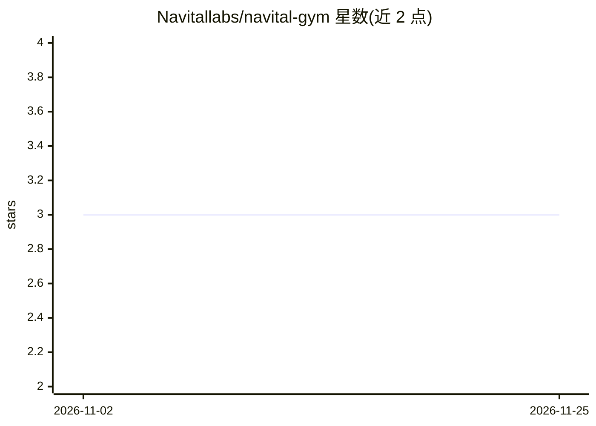

# Navitallabs/navital-gym

⭐ 3 · Python · Apache-2.0 · 推送 2026-11-17 · [GitHub](https://github.com/Navitallabs/navital-gym) · [官网](https://navitallabs.com/labs/navital-gym) · 组织维护

**面向印度现实任务的 AI Agent 确定性评测环境套件**

由 Navital Labs 维护的开源基准套件：6 组沙箱化任务环境（行程规划、UPI 支付、GST 发票、表单填写、多文档核验、印地语/ Hinglish 客服），共约 300 个任务，其中行程环境含 17 个不可行任务。每个任务由书面规则做确定性评分，不使用 LLM 评审，隐藏字段有防泄漏测试强制保障。核心仅依赖 Python 3.10 标准库，提供 Inspect AI、verifiers、OpenEnv 可选适配器，结果发布到公开排行榜。README 明确使用简化规则与合成数据，与印度官方机构无关联。

## 筛选速览

| 维度 | 判定 | 备注 |
|---|---|---|
| AI 角色 | `ai-ecosystem` | LLM/agent 周边工具 |
| 许可风险 | `permissive` | Apache-2.0 |
| 部署形态 | `library` | 以包/库形式分发 |
| 模型依赖 | local-ok | 支持本地模型 |
| 硬件要求 | — | 无带数字的原话,不猜 |
| 安装摩擦 | `low` | 无编译、无系统依赖或容器化 |
| 成熟度 | `idea` | |

## 能力要点

- 6 组环境约 300 个任务，规则评分无 LLM 评审
- 不可行请求检测：错误理由填充计为错误
- 隐藏字段防泄漏有失败测试强制执行
- 核心仅用 Python 3.10+ 标准库，适配器为可选附加项

## 适用场景

- 评测 Agent 处理印度现实场景任务的能力
- 用 OpenAI 兼容 API 跑本地或托管模型并得到 pass@1/pass^k 报告
- 基于文档化的核心接口编写自定义任务环境
- 复现并核对公开的结果表（附再评分脚本）

## 场景标签

`模型评测` · 领域:评测与运维

## 证据(README 行号)

> L7: - **What:** six sets of sandboxed tasks (trip planning, UPI, GST, forms, multi-document forms, customer support in H
> L46: Run any model that speaks the OpenAI chat API with tool calling (Ollama, vLLM, LM Studio, hosted): `--agent "openai

## 星数曲线

2026-11-02 3 → 2026-11-25 3（+0）

---
*卡片 v1 · prompt 1.4 · 生成 2026-11-22 · 置信度 high · 依据 README sha `790380b216b2` · [字段定义](../../DATASET.md)*
