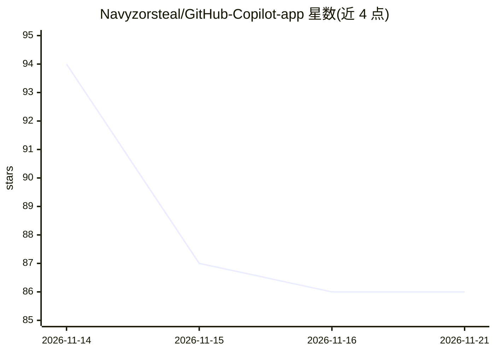

# Navyzorsteal/GitHub-Copilot-app

⭐ 86 · Apache-2.0 · 推送 2026-11-15 · [GitHub](https://github.com/Navyzorsteal/GitHub-Copilot-app) · 组织维护

**GitHub Copilot 官方桌面应用：以 agent 驱动管理软件工作**

GitHub, Inc. 发布的 agent 桌面应用，用于在 GitHub 仓库中查找、运行、引导并落地软件工作：本地会话运行于隔离 git worktree，云端会话运行于 GitHub 托管的隔离环境；提供 Canvases 查看/编辑 agent 工作过程、My Work 聚合会话/issue/PR、Automations 定时任务与 Agent Merge 协助走完评审合并流程。面向持有任意 Copilot 订阅（含 Free/Student）或自带密钥（BYOK）的开发者，从 Releases 页下载安装，闭源且声明保留所有权利。

## 筛选速览

| 维度 | 判定 | 备注 |
|---|---|---|
| AI 角色 | `ai-ecosystem` | LLM/agent 周边工具 |
| 许可风险 | `permissive` | Apache-2.0 |
| 部署形态 | `desktop` | 安装包/桌面程序 |
| 模型依赖 | — | README 未给出锁定关系 |
| 硬件要求 | — | 无带数字的原话,不猜 |
| 安装摩擦 | `low` | 无编译、无系统依赖或容器化 |
| 成熟度 | — | 结构信号不足 |

## 能力要点

- 本地会话各自运行于隔离 git worktree，云端会话运行于 GitHub 托管隔离环境
- Canvases 将计划、终端、diff、工作流状态呈现为可检视/可重定向的共享界面
- Automations 将可重复提示与工作流转为定时或后台任务
- 支持 BYOK 自带模型提供方密钥，无 Copilot 订阅亦可使用

## 适用场景

- 并行驱动多个 agent 处理 bug、issue 与评审反馈
- 统一管理会话、issue、pull request 决定下一步工作
- 把重复性提示和流程设为定时后台任务

## 场景标签

`编码 Agent` · 领域:编码与开发

## 证据(README 行号)

> L13: The GitHub Copilot app is an agent-native desktop experience for managing software work from idea to pull request. 
> L15: The app is built for parallel agent-driven development. Each local session runs in its own isolated git worktree, a

## 星数曲线

2026-11-14 94 → 2026-11-21 86（-8）

---
*卡片 v1 · prompt 1.4 · 生成 2026-11-18 · 置信度 high · 依据 README sha `bf7f8ae6136d` · [字段定义](../../DATASET.md)*
