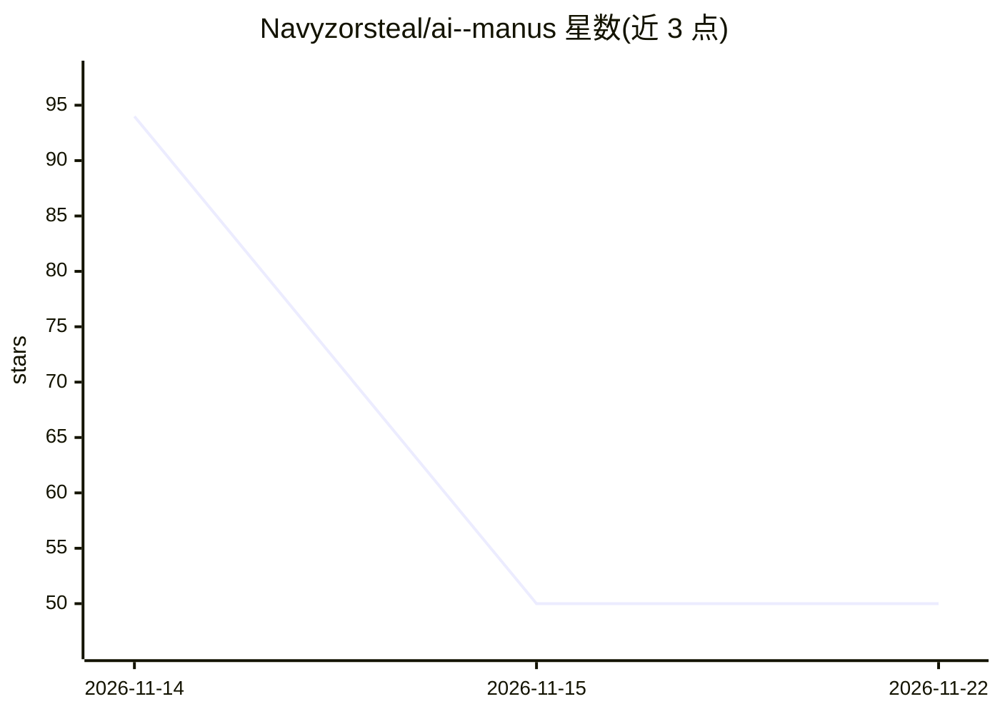

# Navyzorsteal/ai--manus

⭐ 50 · Apache-2.0 · 推送 2026-11-15 · [GitHub](https://github.com/Navyzorsteal/ai--manus) · 个人维护

**面向个人用户的自主 AI Agent：代跑代码与控制浏览器**

自述为通用自主 AI 代理，宣称可代替用户编写并执行脚本、控制浏览器（导航网页、填表、采集信息），并执行多步骤日常任务，定位为家庭、学习与轻量办公场景的个人助理，而非企业平台。README 以功能宣传和使用建议为主，未给出架构、模型接入方式、源码或安装命令等可验证细节，仅列出了硬件兼容性表格（最低 4 GB 内存、双核 CPU）。

## 筛选速览

| 维度 | 判定 | 备注 |
|---|---|---|
| AI 角色 | `ai-native` | 本体是模型或模型工具 |
| 许可风险 | `permissive` | Apache-2.0 |
| 部署形态 | `None` |  |
| 模型依赖 | — | README 未给出锁定关系 |
| 硬件要求 | — | 无带数字的原话,不猜 |
| 安装摩擦 | `low` | 无编译、无系统依赖或容器化 |
| 成熟度 | — | 结构信号不足 |

## 能力要点

- 自述支持自主代码执行与浏览器控制
- 自述可执行多步骤任务并在会话间保持工作流模式
- 列出了最低/推荐硬件兼容性表格

## 适用场景

- 让代理代为完成网页信息采集与表单填写
- 委托代理运行小脚本与整理研究资料
- 日常重复性小任务的自动化

## 场景标签

`AI 助手` `浏览器自动化` `工作流自动化` · 领域:效率与自动化

## 证据(README 行号)

> L10: - **Autonomous Code Execution:** Manus AI agent runs code on its own to complete tasks, so you can focus on decisio
> L18: Manus is an autonomous AI agent designed to run code and control a browser on your behalf. Instead of acting like a

## 星数曲线

2026-11-14 94 → 2026-11-22 50（-44）

---
*卡片 v1 · prompt 1.4 · 生成 2026-11-18 · 置信度 low · 依据 README sha `1b02c25e4c80` · [字段定义](../../DATASET.md)*
