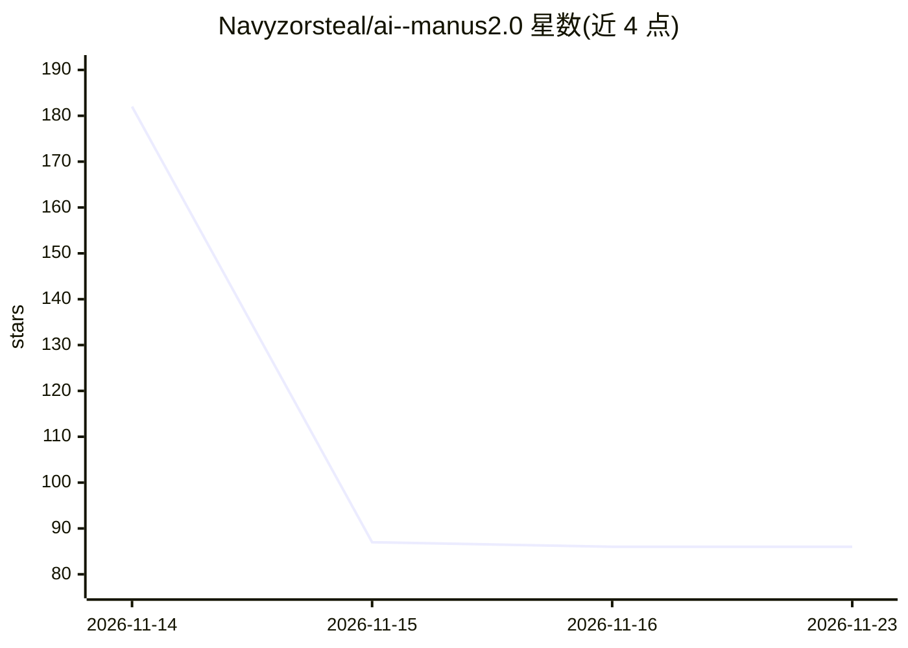

# Navyzorsteal/ai--manus2.0

⭐ 86 · Apache-2.0 · 推送 2026-11-15 · [GitHub](https://github.com/Navyzorsteal/ai--manus2.0) · 个人维护

**自主执行代码与浏览器操作的通用 AI Agent 助手**

Manus 是面向家庭、学习与轻量办公场景的自主 AI Agent：以自然语言指令驱动，可自主编写并执行脚本、控制浏览器（导航网页、填写表单、采集信息）、执行多步骤任务，并支持跨会话保持任务模式。README 未给出可验证的安装命令、源码结构或模型接入细节，仅列出硬件兼容表（最低 4 GB 内存、双核 CPU）与使用步骤说明（准备-配置-测试-精炼-应用-维护）。目标用户为无需编程背景的普通使用者，定位为小规模任务助手而非企业平台。

## 筛选速览

| 维度 | 判定 | 备注 |
|---|---|---|
| AI 角色 | `ai-native` | 本体是模型或模型工具 |
| 许可风险 | `permissive` | Apache-2.0 |
| 部署形态 | `None` |  |
| 模型依赖 | — | README 未给出锁定关系 |
| 硬件要求 | — | 无带数字的原话,不猜 |
| 安装摩擦 | `low` | 无编译、无系统依赖或容器化 |
| 成熟度 | — | 结构信号不足 |

## 能力要点

- 自主编写并执行代码脚本
- 浏览器控制：导航、填表、信息采集
- 脚本与浏览器操作可在同一任务流中衔接
- 跨会话重复应用已学习的工作流模式

## 适用场景

- 用自然语言委派重复性的小任务，减少手动操作
- 学生组织研究笔记、跑快速计算
- 远程工作者从多个网页收集并汇总信息

## 场景标签

`AI 助手` `浏览器自动化` `编码 Agent` · 领域:效率与自动化

## 证据(README 行号)

> L18: Manus is an autonomous AI agent designed to run code and control a browser on your behalf. Instead of acting like a
> L22: Manus is not a heavy studio suite or a complex enterprise platform. It is a focused helper built for home, study, a

## 星数曲线

2026-11-14 182 → 2026-11-23 86（-96）

---
*卡片 v1 · prompt 1.4 · 生成 2026-11-18 · 置信度 mid · 依据 README sha `1b02c25e4c80` · [字段定义](../../DATASET.md)*
