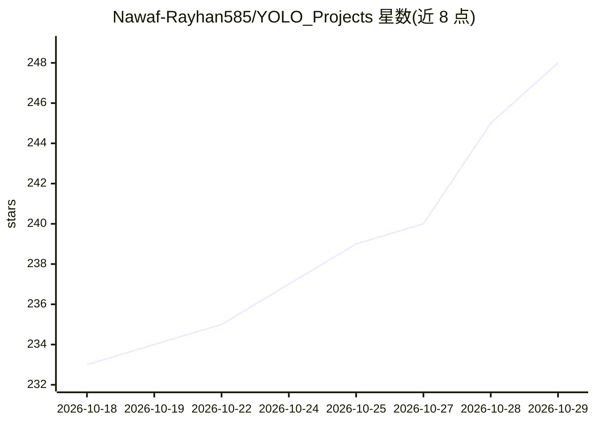

# Nawaf-Rayhan585/YOLO_Projects

⭐ 248 · Python · MIT · 推送 2026-09-23 · [GitHub](https://github.com/Nawaf-Rayhan585/YOLO_Projects) · 个人维护

**19 个可运行的 YOLO 计算机视觉项目合集：检测/跟踪/姿态/OCR**

独立的计算机视觉项目集合，共 19 个可运行项目，覆盖监控安防（入侵报警、跌倒检测、PPE 合规）、零售客流（进出计数、热力图、排队时长）、交通车辆（多目标跟踪、车牌识别 OCR）、生产力与文档处理（手势控制、背景移除、文档扫描 OCR）。技术栈为 Ultralytics YOLO (v8/v11) + ByteTrack、MediaPipe、OpenCV、EasyOCR/Tesseract。每个项目独立文件夹，自带脚本、README 与 requirements.txt，多数用预训练模型即装即跑；少数（火焰、鼠患、车牌、PPE）需用附带 Colab notebook 先训练，仓库不含数据集与权重。MIT 许可。

## 筛选速览

| 维度 | 判定 | 备注 |
|---|---|---|
| AI 角色 | `ai-native` | 本体是模型或模型工具 |
| 许可风险 | `permissive` | MIT |
| 部署形态 | `library` | 以包/库形式分发 |
| 模型依赖 | — | README 未给出锁定关系 |
| 硬件要求 | — | 无带数字的原话,不猜 |
| 安装摩擦 | `low` | 无编译、无系统依赖或容器化 |
| 成熟度 | — | 结构信号不足 |

## 能力要点

- 19 个独立项目，各自带脚本、README 与 requirements.txt
- YOLO (v8/v11) + ByteTrack 跟踪、MediaPipe 姿态/手势、EasyOCR/Tesseract OCR
- 统一 --source 参数接收视频/图片/摄像头
- 需定制模型的项目附带 Colab 训练 notebook（约 15-30 分钟）

## 适用场景

- 我想给工地做安全帽/反光衣合规检测
- 我需要店铺进出客流计数与排队等待时长统计
- 我想实现车牌检测加 OCR 读取
- 我想用手势捏合控制系统音量

## 场景标签

`目标检测` `OCR` `图像视频处理` · 领域:感知与多模态

## 证据(README 行号)

> L7: A collection of 19 standalone, runnable computer vision projects — YOLO
> L62: - **Detection & tracking:** Ultralytics YOLO (v8/v11) + ByteTrack via `supervision`

## 星数曲线

2026-10-18 233 → 2026-10-29 248（+15）

---
*卡片 v1 · prompt 1.4 · 生成 2026-10-22 · 置信度 high · 依据 README sha `911df6dcbe24` · [字段定义](../../DATASET.md)*
