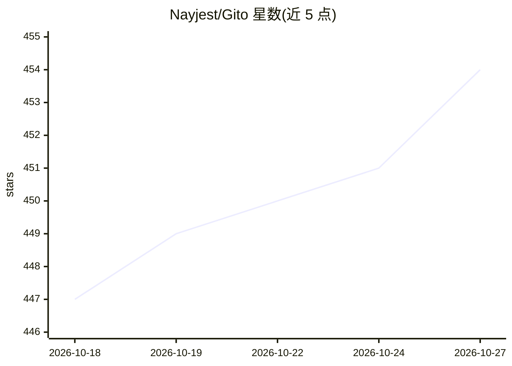

# Nayjest/Gito

⭐ 454 · Python · MIT · 推送 2026-10-01 · [GitHub](https://github.com/Nayjest/Gito) · [官网](http://gito.bot/) · 个人维护

**开源 AI 代码审查工具：审查 GitHub PR 与本地改动**

面向开发者的开源 AI 代码审查器：用 LLM 检测 GitHub pull request 或本地代码变更中的安全漏洞、缺陷与可维护性问题。厂商无关，支持 OpenAI 兼容 API、Anthropic、Google 及 Ollama/vLLM/llama.cpp 等本地运行时，代码直连所选推理提供方，无中间服务器。可通过 GitHub Actions 等 CI/CD 自动审查并以 PR 评论回帖，也可用 CLI 本地运行（gito review）。以 pip 包与 Windows 独立安装器分发；已知限制：无法经默认 GITHUB_TOKEN 修改 workflow 文件。

## 筛选速览

| 维度 | 判定 | 备注 |
|---|---|---|
| AI 角色 | `ai-native` | 本体是模型或模型工具 |
| 许可风险 | `permissive` | MIT |
| 部署形态 | `library` | 以包/库形式分发 |
| 模型依赖 | local-ok | 支持本地模型 |
| 硬件要求 | — | 无带数字的原话,不猜 |
| 安装摩擦 | `medium` | 含编译或系统依赖之一 |
| 成熟度 | — | 结构信号不足 |

## 能力要点

- 厂商无关：支持 OpenAI 兼容 API/Anthropic/Google 及 Ollama、vLLM、llama.cpp 等本地推理
- 并行 LLM 处理，支持 GitHub/GitLab CI/CD 自动审查并以 PR 评论交付结果
- 双层配置模型（环境 + 项目 .gito/config.toml），可自定义审查规则、提示词与输出模板
- 无状态客户端工具，代码不经过中间服务器，零留存

## 适用场景

- 在 PR 流程中自动获得 LLM 代码审查
- 本地分支改动提交前先跑一轮 AI 审查
- 开源项目或团队在 CI/CD 中设置自动化质量门禁

## 场景标签

`代码审查` · 领域:编码与开发

## 证据(README 行号)

> L11: **Gito** is an open-source **AI code reviewer** that works with any language model provider.
> L32: - [🔧] **Vendor Agnostic:** Works with any language model provider (OpenAI, Anthropic, Google, local models, etc.)
> L63: ### 🤖 LLM Providers / Runtimes

## 星数曲线

2026-10-18 447 → 2026-10-27 454（+7）

---
*卡片 v1 · prompt 1.4 · 生成 2026-10-21 · 置信度 high · 依据 README sha `7a717440f236` · [字段定义](../../DATASET.md)*
