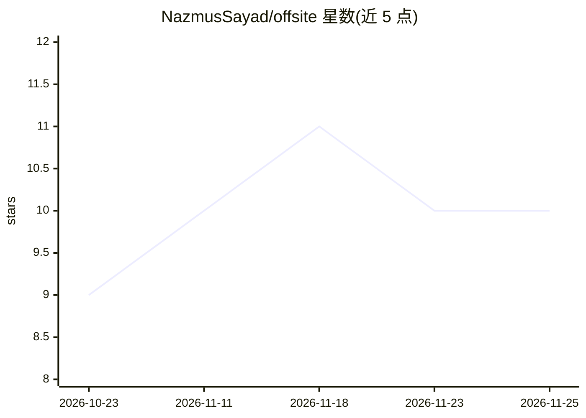

# NazmusSayad/offsite

⭐ 10 · TypeScript · MIT · 推送 2026-11-23 · [GitHub](https://github.com/NazmusSayad/offsite) · [官网](https://offsite.sayad.dev) · 个人维护

**在浏览器中运行 Claude Code/Codex/OpenCode 并与 CLI 共享会话**

OffSite 把 Claude Code、Codex 与 OpenCode 三款编码代理 CLI 的会话带进浏览器界面，读取与各自 CLI 相同的会话数据，因此在终端开始的任务可在网页中继续，反之亦然。界面提供终端、文件预览与 git diff 查看；回复中链接的图片、视频、音频以 Markdown 图片语法内联展示，相对路径以项目文件夹为起点，并通过内置 show 技能让代理学会该语法。通过 npx 运行，可为每个实例指定独立端口与工作目录。

## 筛选速览

| 维度 | 判定 | 备注 |
|---|---|---|
| AI 角色 | `ai-ecosystem` | LLM/agent 周边工具 |
| 许可风险 | `permissive` | MIT |
| 部署形态 | `library` | 以包/库形式分发 |
| 模型依赖 | — | README 未给出锁定关系 |
| 硬件要求 | — | 无带数字的原话,不猜 |
| 安装摩擦 | `low` | 无编译、无系统依赖或容器化 |
| 成熟度 | — | 结构信号不足 |

## 能力要点

- 与 Claude Code/Codex/OpenCode CLI 共享同一套会话，可跨端续接
- 内置终端、文件预览与 git diff 查看
- 图片/视频/音频按 Markdown 图片语法内联展示，内置 show 技能向代理教授该语法
- 支持多实例运行，每实例独立端口与 --dir 工作目录

## 适用场景

- 在浏览器里查看和继续终端中开始的编码代理会话
- 通过网页界面查看代理产出文件与 git 差异
- 为不同项目分别起独立的代理实例

## 场景标签

`编码 Agent` · 领域:编码与开发

## 证据(README 行号)

> L5: Claude Code, Codex and OpenCode in your browser. It uses the same sessions as their CLIs, so you can start in one an
> L10: npx offsite

## 星数曲线

2026-10-23 9 → 2026-11-25 10（+1）

---
*卡片 v1 · prompt 1.4 · 生成 2026-11-19 · 置信度 high · 依据 README sha `da20c16a2c32` · [字段定义](../../DATASET.md)*
