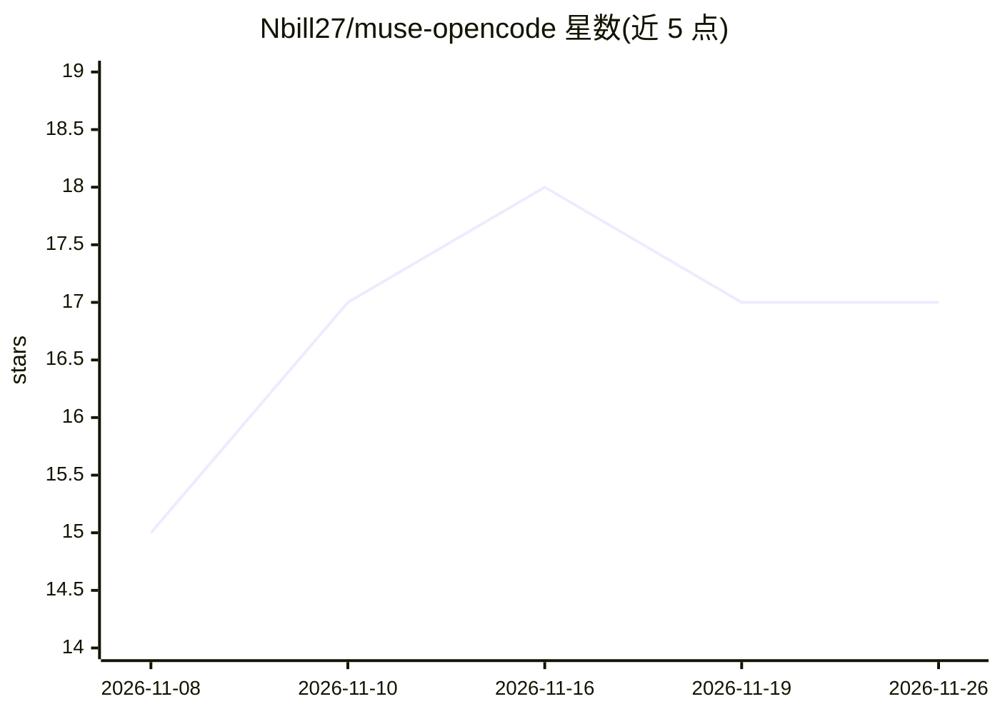

# Nbill27/muse-opencode

⭐ 17 · Python · 推送 2026-11-04 · [GitHub](https://github.com/Nbill27/muse-opencode) · 个人维护

**把 muse.ai 网页聊天封装成 OpenAI 兼容 API 的本地中继**

运行在 127.0.0.1 的 FastAPI 中继服务：通过 Chrome DevTools Protocol 驱动真实 Chromium 标签页操作用户自己的 muse.ai 网页对话，对外暴露 /v1/chat/completions、/v1/images/generations、/v1/videos 等 OpenAI 兼容端点，供 opencode、OpenAI SDK、LangChain 或 curl 调用。认证复用手工提取的 muse.ai 登录 Cookie（session.json），支持多账号池轮换、冷却与故障转移。限制：仅回环地址、单账号并发默认 1、每请求增加数秒浏览器开销、system 消息被丢弃，声明仅供教育用途，不可 pip 安装，需从源码经 start.ps1 运行。

## 筛选速览

| 维度 | 判定 | 备注 |
|---|---|---|
| AI 角色 | `ai-ecosystem` | LLM/agent 周边工具 |
| 许可风险 | `none` | — |
| 部署形态 | `desktop` | 安装包/桌面程序 |
| 模型依赖 | — | README 未给出锁定关系 |
| 硬件要求 | — | 无带数字的原话,不猜 |
| 安装摩擦 | `low` | 无编译、无系统依赖或容器化 |
| 成熟度 | — | 结构信号不足 |

## 能力要点

- 以 OpenAI 兼容 API 形式暴露 chat、图像生成、视频任务端点
- CDP 驱动真实 Chromium 标签页并轮询回复气泡流式回传 SSE
- 多账号池：轮换、冷却、故障转移，默认每账号并发 1
- 热页复用：匹配历史时仅输入增量内容以加速多轮对话

## 适用场景

- 让 opencode 等只支持 OpenAI API 的客户端调用 muse.ai
- 在本地把已有的 muse.ai 网页账号当作 API 服务使用
- 多账号轮换下复用同一 muse.ai 会话做对话与媒体生成

## 场景标签

`模型网关` `图像生成` `视频生成` · 领域:Agent 开发

## 证据(README 行号)

> L5: A local, OpenAI-compatible HTTP relay that drives **your own muse.ai web chat** through a real Chromium tab over the
> L13: - A **relay**, not a scraper library. It runs a FastAPI server on `127.0.0.1` and translates OpenAI request shapes 

## 星数曲线

2026-11-08 15 → 2026-11-26 17（+2）

---
*卡片 v1 · prompt 1.4 · 生成 2026-11-18 · 置信度 mid · 依据 README sha `c78eae7f8a05` · [字段定义](../../DATASET.md)*
