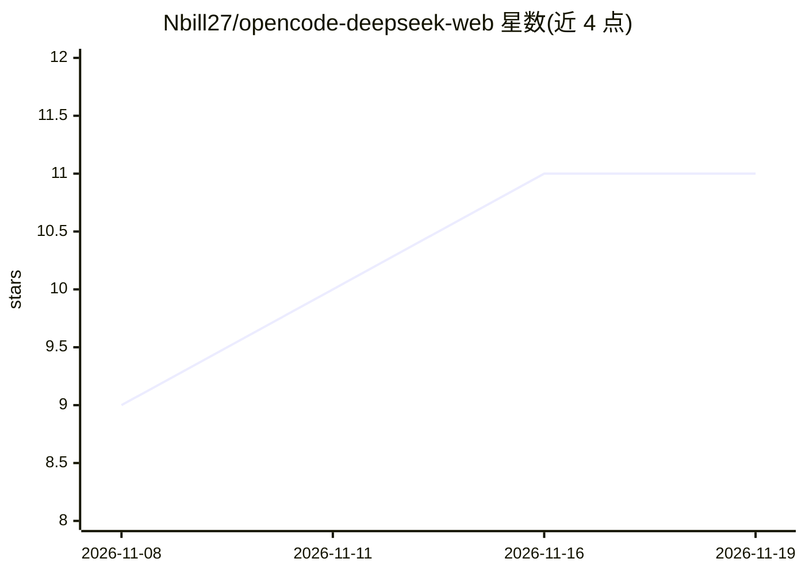

# Nbill27/opencode-deepseek-web

⭐ 11 · Python · MIT · 推送 2026-11-04 · [GitHub](https://github.com/Nbill27/opencode-deepseek-web) · 个人维护

**把免费 DeepSeek 网页账号转为本地 OpenAI 兼容接口供 opencode 使用**

Python 编写的本地中继：从专用 Firefox 配置提取 chat.deepseek.com 登录令牌，在 127.0.0.1:20232 提供 OpenAI 风格的 /v1/chat/completions 端点。上游请求携带浏览器 TLS 指纹、解算的 proof-of-work 头与链式会话 id；以对数正态抖动限速、定期长空闲与失败退避模拟人类节奏。工具调用经文本标签协议双向转换，支持 SSE 流式输出。需 Python 3.10+、Firefox 与 geckodriver；不支持图片/文件输入，usage 为本地估算值。

## 筛选速览

| 维度 | 判定 | 备注 |
|---|---|---|
| AI 角色 | `ai-ecosystem` | LLM/agent 周边工具 |
| 许可风险 | `permissive` | MIT |
| 部署形态 | `desktop` | 安装包/桌面程序 |
| 模型依赖 | locked-api |  |
| 硬件要求 | — | 无带数字的原话,不猜 |
| 安装摩擦 | `low` | 无编译、无系统依赖或容器化 |
| 成熟度 | — | 结构信号不足 |

## 能力要点

- 提供 OpenAI 兼容 /v1/chat/completions 与 SSE 流式输出
- Firefox 令牌提取 + 浏览器 TLS 指纹 + proof-of-work 解算 + 会话链
- 对数正态限速、空闲暂停与失败退避的节奏控制
- 文本标签协议承载工具调用，容忍三种回复方言

## 适用场景

- 让 opencode 编码 agent 使用免费网页账号作为模型后端
- 任何 OpenAI 兼容客户端接入本地回环接口
- 为自治 agent 配置调用节奏避免账号被标记

## 场景标签

`模型网关` · 领域:Agent 开发

## 证据(README 行号)

> L16: |`relay/relay2.py`|serves `POST /v1/chat/completions` on `127.0.0.1:20232`|
> L24: opencode speaks OpenAI. The relay translates:
> L35: Everything binds to loopback. No port forwarding, no public listener.

## 星数曲线

2026-11-08 9 → 2026-11-19 11（+2）

---
*卡片 v1 · prompt 1.4 · 生成 2026-11-19 · 置信度 high · 依据 README sha `29a72c1343ee` · [字段定义](../../DATASET.md)*
