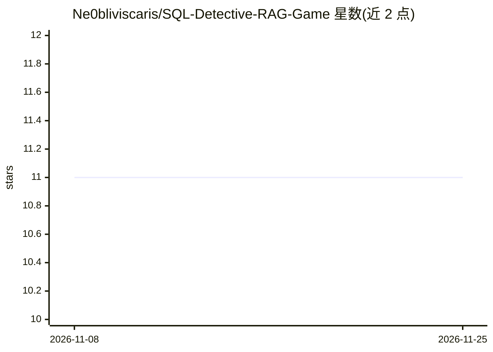

# Ne0bliviscaris/SQL-Detective-RAG-Game

⭐ 11 · Python · 推送 2026-11-04 · [GitHub](https://github.com/Ne0bliviscaris/SQL-Detective-RAG-Game) · 个人维护

**面向游戏玩家的本地 RAG 侦探解谜应用：用自然语言查询数据库破案**

一个交互式破案游戏：玩家扮演侦探，用自然语言提问，由本地小模型将问题翻译为 SQL 查询 SQLite 警用数据库，再由模型对查询结果做上下文分析并给出下一步侦查建议，通过 Streamlit 聊天界面交互并提供侦查笔记记录发现。全部处理在本地完成，不向外部 API 发送数据。技术栈为 Python + LangChain 编排 + Ollama 运行 DeepSeek-R1:1.5b。

## 筛选速览

| 维度 | 判定 | 备注 |
|---|---|---|
| AI 角色 | `ai-native` | 本体是模型或模型工具 |
| 许可风险 | `none` | — |
| 部署形态 | `None` |  |
| 模型依赖 | local-ok | 支持本地模型 |
| 硬件要求 | — | 无带数字的原话,不猜 |
| 安装摩擦 | `low` | 无编译、无系统依赖或容器化 |
| 成熟度 | — | 结构信号不足 |

## 能力要点

- 自然语言到 SQL 的翻译，无需 SQL 知识
- 本地 Ollama 运行 DeepSeek-R1:1.5b，数据不外发
- 检索-增强-生成的完整 RAG 管线（SQL 查询作为检索）
- Translator 与 Detective 双模型分工：转译与推断下一步线索

## 适用场景

- 想体验用自然语言侦查破案的解谜游戏
- 学习如何在本地搭建 RAG + 数据库问答应用
- 在不联网/数据不出本机的环境下使用 LLM 应用

## 场景标签

`聊天机器人` `RAG` `数据分析` · 领域:效率与自动化

## 证据(README 行号)

> L3: SQL Detective is an interactive investigation game where you solve a murder mystery by querying a police database us
> L28: - **Language Model Used**: `DeepSeek-R1:1.5b`
> L29: - **RAG Implementation**: `LangChain` for orchestration and context management

## 星数曲线

2026-11-08 11 → 2026-11-25 11（+0）

---
*卡片 v1 · prompt 1.4 · 生成 2026-11-19 · 置信度 high · 依据 README sha `05da97113db7` · [字段定义](../../DATASET.md)*
