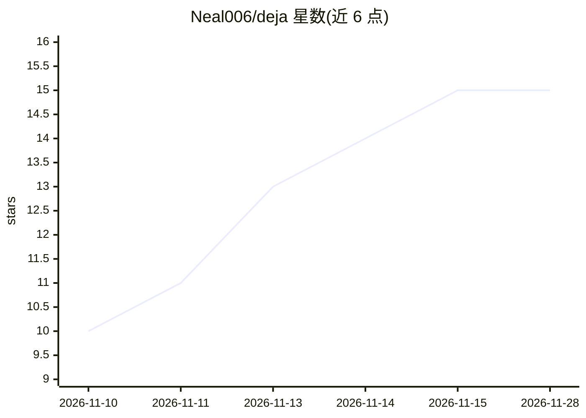

# Neal006/deja

⭐ 15 · TypeScript · MIT · 推送 2026-11-13 · [GitHub](https://github.com/Neal006/deja) · [官网](https://www.npmjs.com/package/dejactx) · 个人维护

**给编码 agent 的本地代理：去重旧上下文并按成本模型逐出，降低 token 账单**

运行在编码 agent 与 LLM API 之间的本地代理（通过 ANTHROPIC_BASE_URL / OPENAI_BASE_URL 接入）。两个引擎：一是 LZ77 式回引用去重，对已出现在对话中的重复工具输出仅发送变更行，且消息 k 的改写是消息 0..k 的纯函数，保持前缀字节一致以维持 prompt cache 命中；二是 ski-rental 成本模型决定何时把陈旧工具输出替换为可重建的存根。README 报告 51 个真实 Claude Code 会话回放中输入账单下降约 30.7%。支持 Anthropic 与 OpenAI 兼容格式（aider、Cline、Ollama、vLLM 等），可作代理或通过 dejaFetch 嵌入自有 agent，运行时零依赖，需 Node 20+。

## 筛选速览

| 维度 | 判定 | 备注 |
|---|---|---|
| AI 角色 | `ai-ecosystem` | LLM/agent 周边工具 |
| 许可风险 | `permissive` | MIT |
| 部署形态 | `library` | 以包/库形式分发 |
| 模型依赖 | local-ok | 支持本地模型 |
| 硬件要求 | — | 无带数字的原话,不猜 |
| 安装摩擦 | `low` | 无编译、无系统依赖或容器化 |
| 成熟度 | — | 结构信号不足 |

## 能力要点

- 回引用去重保持 prompt cache 前缀命中（线上 API 验证）
- ski-rental 成本模型决定陈旧输出逐出时机
- audit 命令从本地历史生成节省对比表，不发送任何内容
- 兼容 OpenAI Chat Completions 格式（Cline/aider/Ollama/vLLM 等）并可嵌入自有 agent

## 适用场景

- 让 Claude Code 等 coding agent 复跑时减少重复 token 支出
- 审计本地会话历史估算上下文成本节省
- 在自有 agent 内以 SDK 方式复用去重/逐出引擎

## 场景标签

`模型网关` · 领域:Agent 开发

## 证据(README 行号)

> L53: deja is a local proxy between your agent and the Anthropic API (`ANTHROPIC_BASE_URL`). It has two engines.
> L127: deja also understands the OpenAI Chat Completions format, so it works with Cline, Roo, OpenCode, aider, Continue, 

## 星数曲线

2026-11-10 10 → 2026-11-28 15（+5）

---
*卡片 v1 · prompt 1.4 · 生成 2026-11-18 · 置信度 high · 依据 README sha `b7d5cd56f74a` · [字段定义](../../DATASET.md)*
