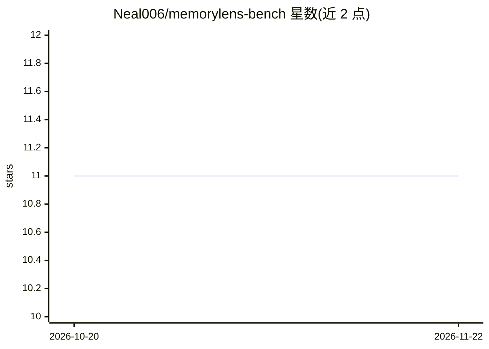

# Neal006/memorylens-bench

⭐ 11 · Python · MIT · 推送 2026-11-14 · [GitHub](https://github.com/Neal006/memorylens-bench) · [官网](https://github.com/Neal006/memorylens) · 个人维护

**测量 LLM 多轮对话记忆衰减的开源基准工具**

面向多轮对话记忆策略的评测框架：通过模拟器在固定回合注入事实，对 8 种记忆架构（naive、RAG、分块 RAG、级联、摘要、实体、知识图谱、FAISS）在 100–200 轮上测量 Recall@T、Precision@K、时序漂移、矛盾、噪声比等 6 项指标，并可拟合 Ebbinghaus 等衰减曲线。核心指标基于内容匹配、无需 API key、可复现；可选接入 LLM 做 answer+judge 评测。以 PyPI 包发布，附 CLI、Python API、Streamlit 面板与 FastAPI 服务。

## 筛选速览

| 维度 | 判定 | 备注 |
|---|---|---|
| AI 角色 | `ai-ecosystem` | LLM/agent 周边工具 |
| 许可风险 | `permissive` | MIT |
| 部署形态 | `library` | 以包/库形式分发 |
| 模型依赖 | local-ok | 支持本地模型 |
| 硬件要求 | — | 无带数字的原话,不猜 |
| 安装摩擦 | `low` | 无编译、无系统依赖或容器化 |
| 成熟度 | — | 结构信号不足 |

## 能力要点

- 8 种记忆架构后端、6 项指标、4 个领域场景（default/edtech/support/medical）
- 零 API key 的确定性内容评测模式，多 seed 输出 mean ± std
- 可拟合 Ebbinghaus 与指数遗忘曲线并报告半衰期与 R²
- 5 家 LLM provider 的可选 answer+judge 评测通道

## 适用场景

- 上线聊天机器人前量化记忆方案在百轮对话后的召回衰减
- 对比不同记忆架构在相同召回率下的 token 开销
- 验证用户事实更新后系统是否返回过期或矛盾信息

## 场景标签

`模型评测` · 领域:评测与运维

## 证据(README 行号)

> L5: **An open-source benchmark for LLM memory decay — 8 memory architectures, 6 metrics, 4 domain scenarios, statistical
> L160: ## LLM Provider Support
> L180: Most evaluation frameworks measure quality at a single point in time. MemoryLens measures how memory quality **cha

## 星数曲线

2026-10-20 11 → 2026-11-22 11（+0）

---
*卡片 v1 · prompt 1.4 · 生成 2026-11-19 · 置信度 high · 依据 README sha `36909f222f43` · [字段定义](../../DATASET.md)*
