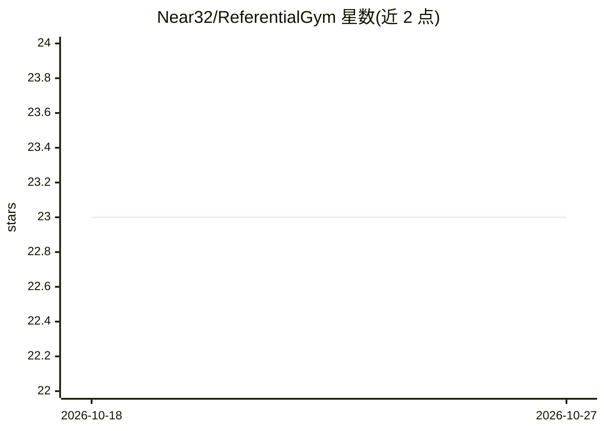

# Near32/ReferentialGym

⭐ 23 · Python · MIT · 推送 2025-12-02 · [GitHub](https://github.com/Near32/ReferentialGym) · 个人维护

**研究人工语言涌现的指代博弈深度学习框架（基于 PyTorch）**

提供多种指代博弈（Referential Games）变体的开箱即用实现，用于借助深度学习研究人工语言的涌现与接地，依赖 PyTorch。包含数据集接口、可由用户自行配置的语言涌现算法，以及拓扑相似度、通信因果影响、FactorVAE 解纠缠度等常用指标实现。配套 Colab 教程与 2020 年 NeurIPS Emergent Communication workshop 论文。自 2019 年 7 月起持续开发；尚未上传 PyPI，需从源码克隆并以 pip install -e 安装，要求 Python 3.6+。

## 筛选速览

| 维度 | 判定 | 备注 |
|---|---|---|
| AI 角色 | `ai-native` | 本体是模型或模型工具 |
| 许可风险 | `permissive` | MIT |
| 部署形态 | `library` | 以包/库形式分发 |
| 模型依赖 | — | README 未给出锁定关系 |
| 硬件要求 | — | 无带数字的原话,不猜 |
| 安装摩擦 | `low` | 无编译、无系统依赖或容器化 |
| 成熟度 | — | 结构信号不足 |

## 能力要点

- 多种指代博弈变体的开箱即用实现，用户可配置
- 提供拓扑相似度等组合性/解纠缠通用指标实现
- 数据集接口适配指代博弈场景
- Colab 教程覆盖入门与自定义模块创建

## 适用场景

- 运行和扩展语言涌现实验
- 评估人工语言通信的组合性与因果影响
- 为新 agent 架构接入指代博弈训练流程

## 场景标签

`科研工具` · 领域:学习与行业

## 证据(README 行号)

> L3: This framework provides out-of-the-box implementations of Referential Games variants in order to study the emergence
> L15: + Provides state-of-the-art language emergence algorithms based on referential game variants that can be configured
> L16: + Provides common implementations of various metrics, e.g. topographic similarity as a compositionality metric, cau

## 星数曲线

2026-10-18 23 → 2026-10-27 23（+0）

---
*卡片 v1 · prompt 1.4 · 生成 2026-10-27 · 置信度 mid · 依据 README sha `853e0d3716a7` · [字段定义](../../DATASET.md)*
