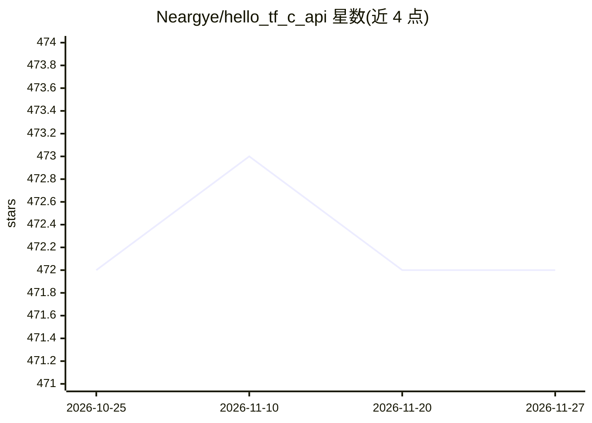

# Neargye/hello_tf_c_api

⭐ 472 · C++ · MIT · 推送 2026-11-26 · [GitHub](https://github.com/Neargye/hello_tf_c_api) · 个人维护

**TensorFlow C API 的跨平台 C/C++ 示例集与小型辅助库**

为 Windows/Linux/macOS 提供的 TensorFlow C API 示例集合，附带一个小型 C++ 辅助库（张量创建/分配、会话创建、错误状态读取等）。构建依赖 CMake 3.20+、C++17 编译器与 Python 3.10–3.13，CMake 自动下载 TensorFlow 2.21.0 wheel 并链接其原生库，无需将 TensorFlow 装入 Python 环境。含 OpenCV 可选示例。以 git clone + CMake 源码构建方式提供，无可安装的 CMake 包。

## 筛选速览

| 维度 | 判定 | 备注 |
|---|---|---|
| AI 角色 | `ai-native` | 本体是模型或模型工具 |
| 许可风险 | `permissive` | MIT |
| 部署形态 | `desktop` | 安装包/桌面程序 |
| 模型依赖 | — | README 未给出锁定关系 |
| 硬件要求 | — | 无带数字的原话,不猜 |
| 安装摩擦 | `medium` | 含编译或系统依赖之一 |
| 成熟度 | — | 结构信号不足 |

## 能力要点

- 直接调用 TensorFlow C API 的原始 C 示例与简化封装的 C++ 示例
- 辅助库提供 CreateTensor/AllocateTensor/CreateSession/RunSession 等接口
- CMake 自动下载并链接 TensorFlow wheel，Windows 下复制运行时 DLL
- OpenCV 可选集成，用于图像张量示例

## 适用场景

- 学习如何在 C/C++ 中通过 TensorFlow C API 加载图与运行推理
- 在跨平台 C++ 项目中封装 TensorFlow C API 调用
- 参考张量创建、批量与重复推理的实现方式

## 场景标签

`教程课程` · 领域:学习与行业

## 证据(README 行号)

> L5: TensorFlow C API examples for Windows, Linux, and macOS, with a small C++ helper library.
> L54: - TensorFlow version, load a graph.

## 星数曲线

2026-10-25 472 → 2026-11-27 472（+0）

---
*卡片 v1 · prompt 1.4 · 生成 2026-11-27 · 置信度 high · 依据 README sha `c53e83b60a8b` · [字段定义](../../DATASET.md)*
