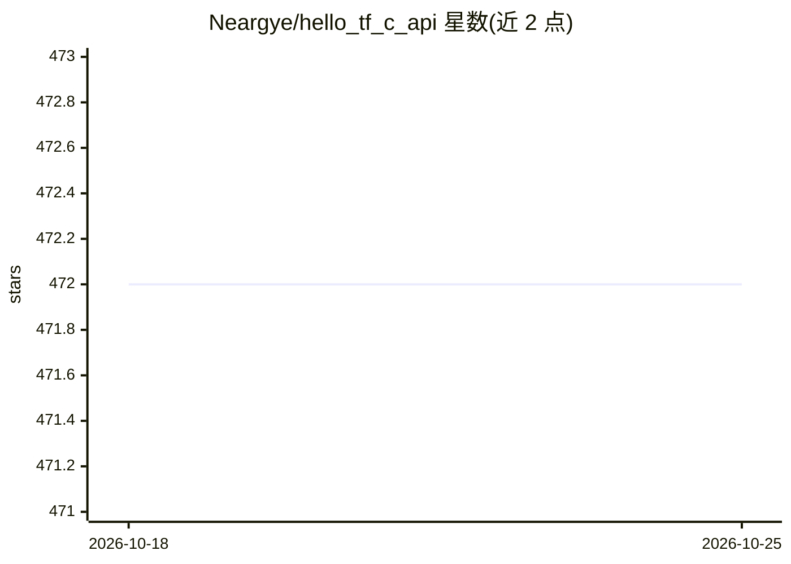

# Neargye/hello_tf_c_api

⭐ 472 · C++ · MIT · 推送 2026-09-20 · [GitHub](https://github.com/Neargye/hello_tf_c_api) · 个人维护

**TensorFlow C API 的 C++ 示例集与轻量辅助库**

面向使用 TensorFlow C API 的 C/C++ 开发者：提供跨 Windows/Linux/macOS 的示例程序，覆盖加载图、创建张量、运行会话、批量与重复推理、图信息读取等操作，并附带一个小型 C++ 辅助库（tf_utils.hpp，如类型推断的 CreateTensor、返回 TF_Code 的错误安全读取重载）。构建基于 CMake，自动下载 TensorFlow wheel 并链接其原生库，无需在 Python 环境安装 TensorFlow；OpenCV 为可选依赖。MIT 许可。

## 筛选速览

| 维度 | 判定 | 备注 |
|---|---|---|
| AI 角色 | `ai-ecosystem` | LLM/agent 周边工具 |
| 许可风险 | `permissive` | MIT |
| 部署形态 | `desktop` | 安装包/桌面程序 |
| 模型依赖 | — | README 未给出锁定关系 |
| 硬件要求 | — | 无带数字的原话,不猜 |
| 安装摩擦 | `medium` | 含编译或系统依赖之一 |
| 成熟度 | — | 结构信号不足 |

## 能力要点

- 覆盖加载图/张量创建/会话运行/批量推理的 C API 示例集
- C++ 辅助库 hello_tf_utils 提供类型推断与错误安全的封装
- CMake 自动下载 TensorFlow wheel 并链接原生库，支持用已有 wheel 提取物
- 支持 Windows(Visual Studio)/Linux/macOS 三平台构建与 ctest 测试

## 适用场景

- 学习 TensorFlow C API 的调用方式与常见操作
- 在 C++ 项目中复用张量创建与会话运行的辅助封装
- 作为 C API 推理工程的构建模板（含 OpenCV 图像张量示例）

## 场景标签

`教程课程` · 领域:学习与行业

## 证据(README 行号)

> L5: TensorFlow C API examples for Windows, Linux, and macOS, with a small C++ helper library.
> L61: See tf_utils.hpp for declarations. Within this CMake project, link the helpers with:

## 星数曲线

2026-10-18 472 → 2026-10-25 472（+0）

---
*卡片 v1 · prompt 1.4 · 生成 2026-10-21 · 置信度 high · 依据 README sha `633f2115b23e` · [字段定义](../../DATASET.md)*
