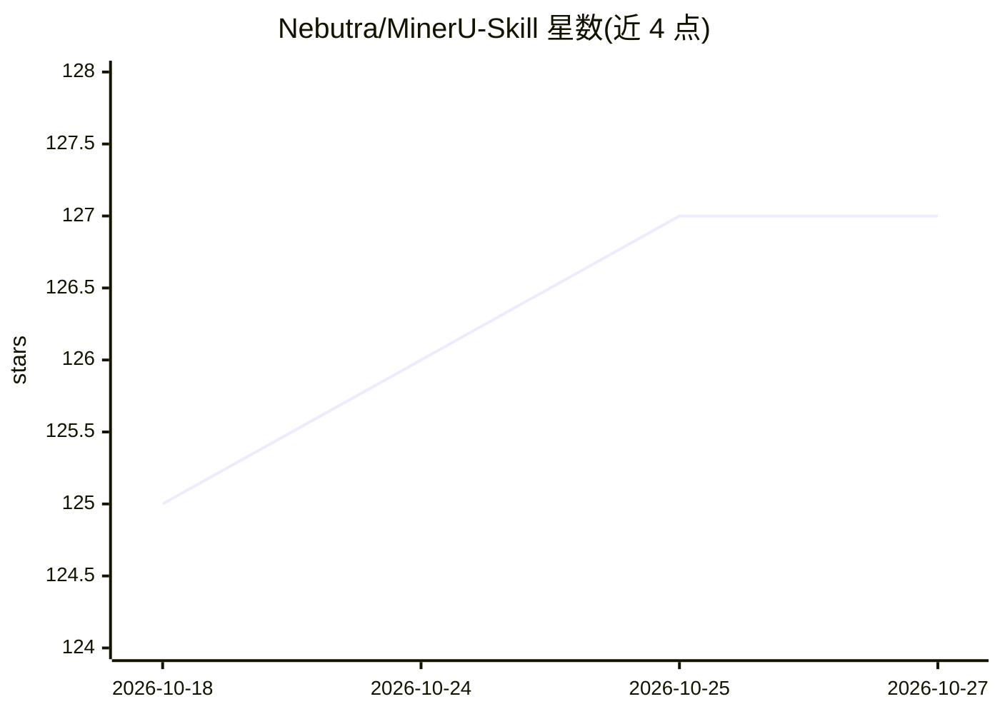

# Nebutra/MinerU-Skill

⭐ 127 · Python · MIT · 推送 2026-09-24 · [GitHub](https://github.com/Nebutra/MinerU-Skill) · [官网](https://smithery.ai/skills/nebutra/mineru-skill) · 个人维护 · 中文 README

**面向 AI agent 的零依赖文档解析 CLI/技能：PDF/Office/图片转 Markdown**

MinerU 云端 API 之上的零配置、零依赖封装层：单个约 54KB 的纯 Python stdlib 脚本，把 PDF、Word、PPT、Excel、图片与 HTML 解析为保留 LaTeX 公式和表格的 Markdown，通过免费 Agent API 无 token 启动，设置 MINERU_TOKEN 后自动升级到 Standard API（200MB/200 页、并行批处理、DOCX/HTML/LaTeX 导出）。面向 Claude Code、Cursor、Codex 等 35+ agent 的使用者，提供 17 个一次性投递目标（Obsidian、Notion、语雀、飞书、钉钉等）、--resume 断点续传与 MCP server。限制：文件上传至 MinerU 云端，非离线方案；精度等同于 MinerU 云端。

## 筛选速览

| 维度 | 判定 | 备注 |
|---|---|---|
| AI 角色 | `ai-native` | 本体是模型或模型工具 |
| 许可风险 | `permissive` | MIT |
| 部署形态 | `library` | 以包/库形式分发 |
| 模型依赖 | — | README 未给出锁定关系 |
| 硬件要求 | — | 无带数字的原话,不猜 |
| 安装摩擦 | `low` | 无编译、无系统依赖或容器化 |
| 成熟度 | — | 结构信号不足 |

## 能力要点

- 零安装、零 API key 启动（免费 Agent API，纯 stdlib 核心）
- PDF/Word/PPT/Excel/图片/HTML 转 Markdown，保留 LaTeX 公式与表格
- 17 个投递目标：Obsidian、Notion、Confluence、语雀、飞书、Slack 等
- --stdout/--json 输出、并行 --workers 批处理、--resume 去重、零依赖 MCP server

## 适用场景

- 让 Claude Code/Cursor 等 agent 直接解析 PDF 并投递到我的笔记工具
- 批量并行解析论文目录为 Markdown 存入 Obsidian
- 为 RAG 流水线生成标题感知的分块（--chunk）

## 场景标签

`文档解析` · 领域:知识与检索

## 证据(README 行号)

> L9: **An AI-Native document parser built for AI agents** — turn PDF, Office & image files into clean Markdown with _zero
> L50: MinerU Skill is **not a new parsing engine** — it is a zero-config, zero-dependency, agent-native **convenience lay

## 星数曲线

2026-10-18 125 → 2026-10-27 127（+2）

---
*卡片 v1 · prompt 1.4 · 生成 2026-10-23 · 置信度 mid · 依据 README sha `fc45a44c3774` · [字段定义](../../DATASET.md)*
