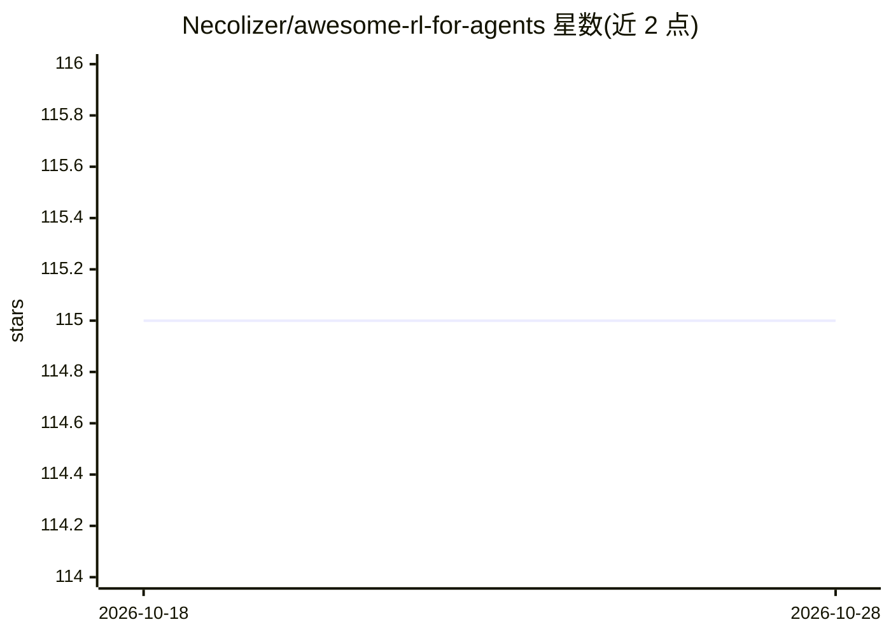

# Necolizer/awesome-rl-for-agents

⭐ 115 · CC0-1.0 · 推送 2026-10-26 · [GitHub](https://github.com/Necolizer/awesome-rl-for-agents) · 个人维护

**面向 LLM/MLLM 智能体的强化学习论文与工具策展清单**

个人维护的 awesome 清单，收集用强化学习训练或调优 LLM/MLLM 智能体的论文、工具与演示。内容按主题分类：综述、计算机使用智能体、研究智能体、工具使用问题求解、自我博弈、智能体记忆、多模态智能体、技能强化学习、RL 扩展等。每条目附论文/预印本链接，多数附开源代码仓库。定位为个人持续更新的资源合集，与正式综述无关联，面向从事智能体强化学习研究的人员。

## 筛选速览

| 维度 | 判定 | 备注 |
|---|---|---|
| AI 角色 | `ai-knowledge` | 知识聚合/清单类 |
| 许可风险 | `viral` | CC0-1.0 |
| 部署形态 | `None` |  |
| 模型依赖 | — | README 未给出锁定关系 |
| 硬件要求 | — | 无带数字的原话,不猜 |
| 安装摩擦 | `low` | 无编译、无系统依赖或容器化 |
| 成熟度 | — | 结构信号不足 |

## 能力要点

- 覆盖 9+ 个智能体 RL 研究方向的论文条目
- 多数条目附 arXiv 预印本与开源代码链接
- 按计算机使用/研究/工具使用/记忆/多模态等主题组织

## 适用场景

- 查找某个智能体 RL 方向的最新论文与代码
- 了解 RL 训练 LLM 智能体的研究主题划分
- 跟踪智能体强化学习领域的新工作

## 场景标签

`精选清单` `强化学习` · 领域:学习与行业

## 证据(README 行号)

> L3: A curated list of reinforcement learning (RL) for agents.
> L5: > This list collects papers, tools, and demos that demonstrate how reinforcement learning can be applied to train or

## 星数曲线

2026-10-18 115 → 2026-10-28 115（+0）

---
*卡片 v1 · prompt 1.4 · 生成 2026-10-23 · 置信度 high · 依据 README sha `dbe4eef0b982` · [字段定义](../../DATASET.md)*
