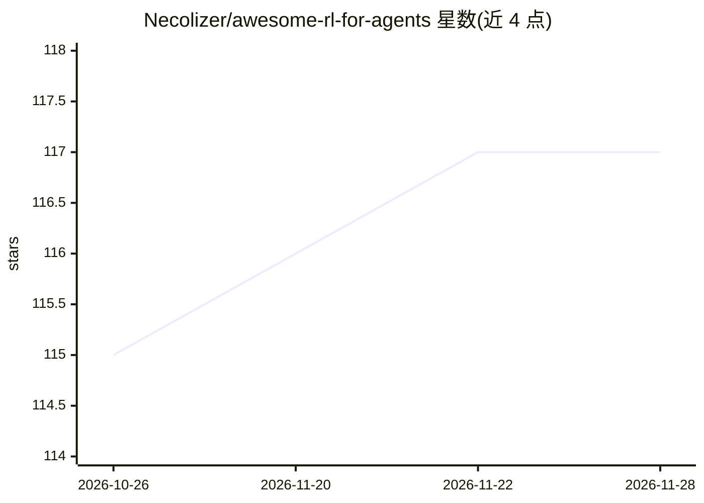

# Necolizer/awesome-rl-for-agents

⭐ 117 · CC0-1.0 · 推送 2026-11-23 · [GitHub](https://github.com/Necolizer/awesome-rl-for-agents) · 个人维护

**面向研究者与开发者的 Agent 强化学习论文资源清单**

一个个人维护的精选清单，收集将强化学习应用于训练或调优 LLM/MLLM Agent 的论文、工具与演示，按计算机操作 Agent、研究 Agent、工具使用、自博弈、Agent 记忆、多模态 Agent、技能学习与 RL 扩展等主题分类组织。条目提供 arXiv 预印本、代码仓库或博客链接。维护者声明为个人持续更新的资源集合，与其他综述无关。

## 筛选速览

| 维度 | 判定 | 备注 |
|---|---|---|
| AI 角色 | `ai-knowledge` | 知识聚合/清单类 |
| 许可风险 | `viral` | CC0-1.0 |
| 部署形态 | `None` |  |
| 模型依赖 | — | README 未给出锁定关系 |
| 硬件要求 | — | 无带数字的原话,不猜 |
| 安装摩擦 | `low` | 无编译、无系统依赖或容器化 |
| 成熟度 | — | 结构信号不足 |

## 能力要点

- 按 8 个主题分类组织 RL for Agents 的论文条目
- 条目附 arXiv 预印本、代码仓库与博客链接
- 覆盖计算机操作、搜索研究、工具调用、多模态等 Agent 方向
- 个人维护并声明持续更新

## 适用场景

- 查找用强化学习训练 LLM Agent 的相关论文与开源实现
- 调研 GUI/计算机操作 Agent 的 RL 训练方法
- 检索工具调用与深度研究 Agent 的 RL 训练资源

## 场景标签

`精选清单` · 领域:学习与行业

## 证据(README 行号)

> L3: A curated list of reinforcement learning (RL) for agents.
> L5: > This list collects papers, tools, and demos that demonstrate how reinforcement learning can be applied to train or
> L9: ## 📚 Papers & Research

## 星数曲线

2026-10-26 115 → 2026-11-28 117（+2）

---
*卡片 v1 · prompt 1.4 · 生成 2026-11-28 · 置信度 high · 依据 README sha `50fe00493da9` · [字段定义](../../DATASET.md)*
