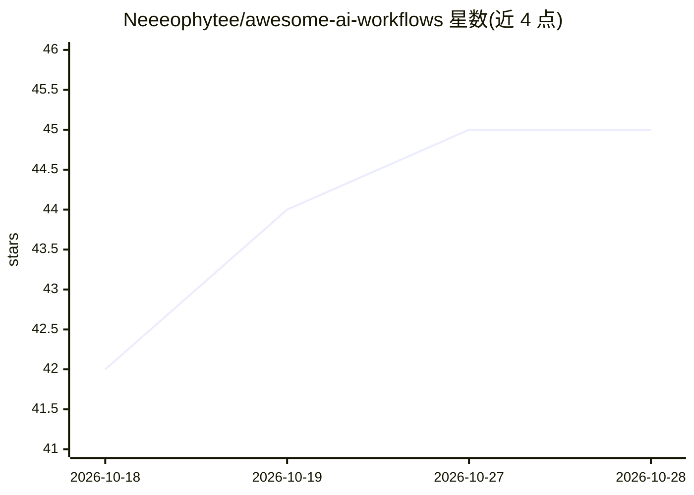

# Neeeophytee/awesome-ai-workflows

⭐ 45 · Shell · NOASSERTION · 推送 2026-10-12 · [GitHub](https://github.com/Neeeophytee/awesome-ai-workflows) · 个人维护

**CI 验证的 AI 工作流配方清单（134 条，含编码与 Agent 编排）**

由 FlowStacks 提供支持的策展式 AI 工作流配方索引，覆盖编码与代码评审、Agent 编排、RAG 管道、本地推理与自动化等类别。每条配方链接到一个展示其当前是否可运行的页面，其中 134 条的确定性部分接入 CI，在每次变更时自动验证；某步骤失效时徽章自动降级。配方式涵盖 Claude Code、Codex、OpenCode、Aider、OpenHands 等工具的用法，许可为 CC0-1.0。

## 筛选速览

| 维度 | 判定 | 备注 |
|---|---|---|
| AI 角色 | `ai-knowledge` | 知识聚合/清单类 |
| 许可风险 | `none` | NOASSERTION |
| 部署形态 | `None` |  |
| 模型依赖 | — | README 未给出锁定关系 |
| 硬件要求 | — | 无带数字的原话,不猜 |
| 安装摩擦 | `low` | 无编译、无系统依赖或容器化 |
| 成熟度 | — | 结构信号不足 |

## 能力要点

- 134 条配方接入 CI 在每次变更时自动验证
- 覆盖编码代理、Agent 编排、本地推理、RAG 等类别
- 每条配方附带 CI 验证或 author-tested 状态标识
- 配方失效时验证徽章自动降级

## 适用场景

- 查找仍可运行的编码代理与 Agent 编排工作流
- 为 CI 中的代码评审或测试自愈环节参考现成配方
- 按工具（Claude Code/Codex/OpenCode 等）浏览用法示例

## 场景标签

`精选清单` · 领域:学习与行业

## 证据(README 行号)

> L15: A curated index of AI workflows that real builders actually run: agent harnesses, local-inference setups, RAG pipel
> L17: Why "verified" is the whole point: AI recipes rot fast. Models change, flags break, packages move. A recipe that ra

## 星数曲线

2026-10-18 42 → 2026-10-28 45（+3）

---
*卡片 v1 · prompt 1.4 · 生成 2026-10-25 · 置信度 high · 依据 README sha `16904ad0b26a` · [字段定义](../../DATASET.md)*
