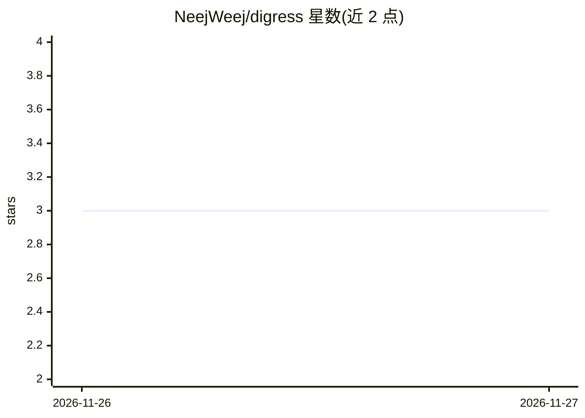

# NeejWeej/digress

⭐ 3 · Python · MIT · 推送 2026-11-26 · [GitHub](https://github.com/NeejWeej/digress) · [官网](https://neejweej.github.io/digress/) · 个人维护

**自托管的分支式学习聊天应用：高亮提问生成旁支**

面向学习场景的对话工具：用户在回答中选中任意词句提问，回答以独立分支窗格在旁边展开，主线程保持可读；分支可再分支，支持 Takeaway 摘要回写父线程、同一问题的多版本对比、PDF/Markdown/网页文档共读与页码引用，以及基于 FSRS 的可选闪卡复习（可离线）。带浏览器演示（预置回复、无真实模型）。需接入用户自己的 Claude 或 ChatGPT 账户，运行在本地机器上。

## 筛选速览

| 维度 | 判定 | 备注 |
|---|---|---|
| AI 角色 | `ai-native` | 本体是模型或模型工具 |
| 许可风险 | `permissive` | MIT |
| 部署形态 | `None` |  |
| 模型依赖 | — | README 未给出锁定关系 |
| 硬件要求 | — | 无带数字的原话,不猜 |
| 安装摩擦 | `low` | 无编译、无系统依赖或容器化 |
| 成熟度 | — | 结构信号不足 |

## 能力要点

- 高亮词句提问生成分支，分支树可视化（Columns/Rows/Canvas 三视图）
- 从 PDF、Markdown、网页文章等文档开始对话，模型可搜索和分页阅读文档
- 多版本重问/编辑问题，对比后选择继续的版本
- 可选 FSRS 间隔重复闪卡，支持离线复习与后台同步

## 适用场景

- 阅读长 PDF 讲义时对不理解的句子深入追问而不打断主线
- 围绕文档学习并生成闪卡做间隔复习
- 对同一问题尝试不同模型/问法并比较回答

## 场景标签

`聊天机器人` `文档问答` `知识库管理` · 领域:对话与助手

## 证据(README 行号)

> L3: **A branching chat for learning.** Highlight any words in an answer, ask about them, and the reply opens in its own 
> L7: **Try the demo** in your browser, nothing to install. It's the real app with a sample reading and conversation, but 

## 星数曲线

2026-11-26 3 → 2026-11-27 3（+0）

---
*卡片 v1 · prompt 1.4 · 生成 2026-11-26 · 置信度 high · 依据 README sha `7b94e5a6c629` · [字段定义](../../DATASET.md)*
