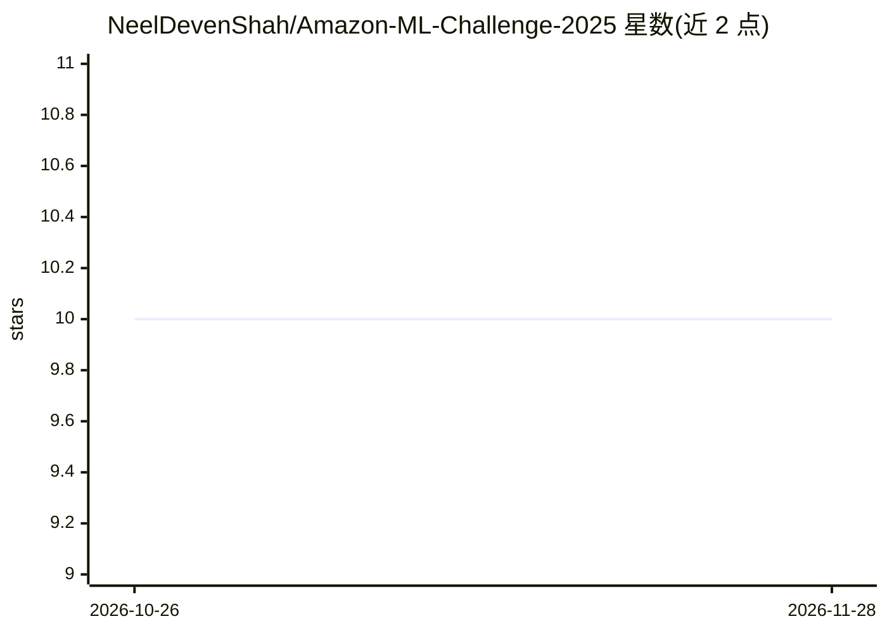

# NeelDevenShah/Amazon-ML-Challenge-2025

⭐ 10 · Jupyter Notebook · 推送 2026-01-04 · [GitHub](https://github.com/NeelDevenShah/Amazon-ML-Challenge-2025) · 组织维护

**Amazon ML Challenge 2025 价格预测竞赛的高排名解决方案集**

该仓库收录 Team ML Mavericks 参加 Amazon ML Challenge 2025 商品价格预测任务的多套方案，共 35+ 个 notebook，分为探索性数据分析、多模态（CLIP、Qwen2.5 微调）与纯文本（Granite、FLAN-T5、BERT、梯度提升、集成）三类方法，最终方案为带验证-测试差距修正的混合集成（SMAPE 43.28，全印度排名 80/23,000+ 队）。面向参与该竞赛或学习特征工程与模型集成方法的数据科学人员，各 notebook 附说明文档；仓库未提供安装命令，需按各 folder 内 README 自行运行。

## 筛选速览

| 维度 | 判定 | 备注 |
|---|---|---|
| AI 角色 | `ai-knowledge` | 知识聚合/清单类 |
| 许可风险 | `none` | — |
| 部署形态 | `None` |  |
| 模型依赖 | — | README 未给出锁定关系 |
| 硬件要求 | — | 无带数字的原话,不猜 |
| 安装摩擦 | `low` | 无编译、无系统依赖或容器化 |
| 成熟度 | — | 结构信号不足 |

## 能力要点

- 35+ 个覆盖传统 ML 到 LLM 的 notebook 实现
- 多模态方法：CLIP 图像+品牌特征、Qwen2.5 视觉语言模型微调
- 最终混合集成方案含验证-测试差距修正
- 每个 notebook 附架构说明与预期性能指标

## 适用场景

- 参考竞赛最终方案复现价格预测流水线
- 学习电商文本/图像特征工程与集成技巧
- 查阅 BERT/T5/LLM 在回归任务上的不同实现

## 场景标签

`微调` · 领域:训练与推理

## 证据(README 行号)

> L3: This repository contains various approaches for the Amazon ML Challenge 2025 price prediction task.
> L126: **Total**: 30+ implementations covering the full spectrum from traditional ML to state-of-the-art LLMs
> L230: **Total**: 35+ fully documented notebooks across all approaches!

## 星数曲线

2026-10-26 10 → 2026-11-28 10（+0）

---
*卡片 v1 · prompt 1.4 · 生成 2026-11-20 · 置信度 high · 依据 README sha `a9f6c74212ac` · [字段定义](../../DATASET.md)*
