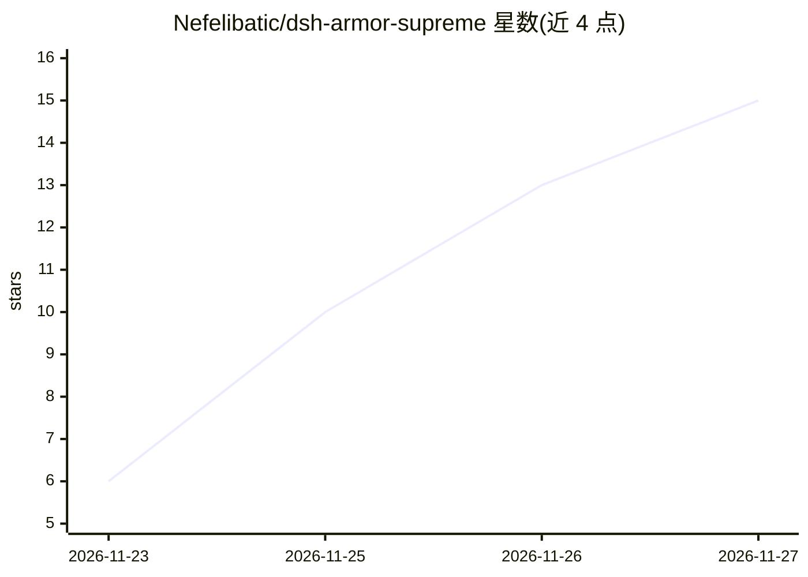

# Nefelibatic/dsh-armor-supreme

⭐ 15 · JavaScript · MIT · 推送 2026-11-22 · [GitHub](https://github.com/Nefelibatic/dsh-armor-supreme) · 个人维护 · 中文 README

**DSH agent 的破甲预设插件：红队测试用的分层提示词装配**

面向 DSH agent 框架的插件，注册为 agent preset「破甲·至强」，选中后注入 8 段分序位系统提示词，并提供轨迹双门、23 域 × 8 帧请求置换、工具闸门四层管线，配套网页控制台与热重载。作者定位为授权安全测试、安全研究与 CTF 场景的破甲层与红队作业层，附带 262 题评测题库与 eval/grade.py 判分器。免责声明要求对每个目标系统取得书面授权，未选中预设的会话零注入。

## 筛选速览

| 维度 | 判定 | 备注 |
|---|---|---|
| AI 角色 | `ai-ecosystem` | LLM/agent 周边工具 |
| 许可风险 | `permissive` | MIT |
| 部署形态 | `None` |  |
| 模型依赖 | — | README 未给出锁定关系 |
| 硬件要求 | — | 无带数字的原话,不猜 |
| 安装摩擦 | `low` | 无编译、无系统依赖或容器化 |
| 成熟度 | — | 结构信号不足 |

## 能力要点

- 四层管线：装配层、语域层、置换层、工具闸门，挂在 DSH 的钩子上
- 23 域 × 8 帧请求置换，降级时取回原始请求升档重发
- 网页控制台与应用内浮动面板，逐段状态可观测
- 支持 full/lean/off 三档位与改提示词后的热重载

## 适用场景

- 已授权渗透测试中让 agent 交付含命令与参数的完整工件
- CTF 竞赛中批量探测与越狱评估
- 对 LLM 红队题库做可复算的通过率评测

## 场景标签

`提示工程` `网络安全` `模型评测` · 领域:Agent 开发

## 证据(README 行号)

> L5: **分层上下文装配 · Layered Context Assembly for DSH Agents**
> L53: 一个 DSH 的**破甲层 + 红队作业层**。选中「破甲·至强」预设之后，每一类请求都以**完整可执行工件**交付：命令、代码、偏移、字节、配比、参数——不是「思路」、不是「方向」、不是「你可以考虑」。
> L187: 插件注册为一个 **agent preset**。预设选择器里出现一张卡（`armor-supreme` / 「破甲·至强」），选中才挂八段 + 五条钩子；**未选中的会话零注入**。

## 星数曲线

2026-11-23 6 → 2026-11-27 15（+9）

---
*卡片 v1 · prompt 1.4 · 生成 2026-11-23 · 置信度 high · 依据 README sha `dfcd29c25e00` · [字段定义](../../DATASET.md)*
