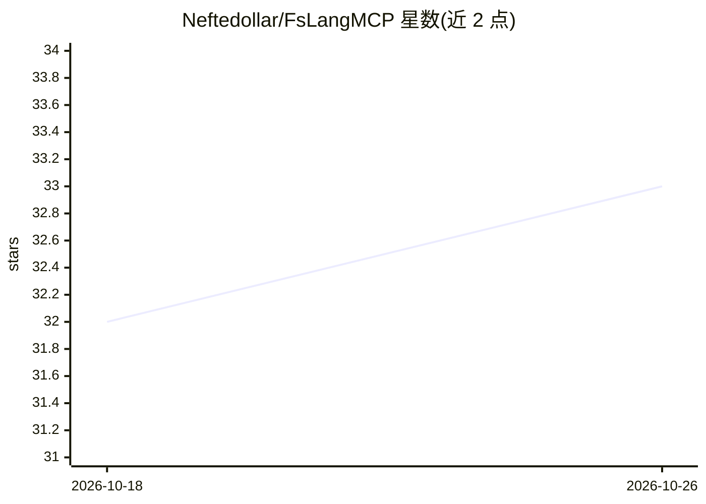

# Neftedollar/FsLangMCP

⭐ 33 · F# · MIT · 推送 2026-10-25 · [GitHub](https://github.com/Neftedollar/FsLangMCP) · 个人维护

**给 AI 编程 Agent 的 F# 语义工具 MCP 服务器**

面向 Claude Code、Cursor、Copilot、Codex 等 AI 编程代理的 MCP 服务器，通过 F# 编译器服务（FCS 进程内 + FSAC LSP）提供语义级代码智能，替代文本搜索：跨项目符号查找、可信编译判定（clean/errors/unknown）、类型查询、重命名预览、死代码与公共 API 分析等，共 35 个工具、8 组。安装需 .NET SDK 10+，通过 dotnet tool 全局安装，bootstrap 命令会安装指定版本的 FSAC、ProjInfo 与 Fantomas。支持多 agent 并行使用（FCS 工具按项目缓存），LSP 工具强制串行。

## 筛选速览

| 维度 | 判定 | 备注 |
|---|---|---|
| AI 角色 | `ai-ecosystem` | LLM/agent 周边工具 |
| 许可风险 | `permissive` | MIT |
| 部署形态 | `None` |  |
| 模型依赖 | — | README 未给出锁定关系 |
| 硬件要求 | — | 无带数字的原话,不猜 |
| 安装摩擦 | `medium` | 含编译或系统依赖之一 |
| 成熟度 | — | 结构信号不足 |

## 能力要点

- 基于 FCS/FSAC 真实编译器语义的符号解析，替代 grep
- 35 个工具覆盖查找、编译判定、诊断修复、重构预览、公共 API 与 NuGet 类型枚举
- bootstrap 机制按发行版固定 FSAC/ProjInfo/Fantomas 版本
- 支持多 agent 并行（FCS 工具按 projectPath 隔离缓存）

## 适用场景

- 让 AI 编程 Agent 用语义搜索定位 F# 符号而非文本 grep
- Agent 编辑 F# 代码后快速获得编译判定与诊断修复建议
- 重构前预览语义重命名与影响范围
- 审计 F# 项目的死代码与公共 API 变化

## 场景标签

`编码 Agent` · 领域:编码与开发

## 证据(README 行号)

> L1: # FsLangMCP — semantic F# for your AI coding agent
> L3: **Stop your agent grepping F#.** Give it the real compiler: cross-project `find`, a trustworthy `check` verdict, typ
> L20: Text search misses the semantics F# depends on — partial application, aliased `open`s, shadowed bindings, cross-pro

## 星数曲线

2026-10-18 32 → 2026-10-26 33（+1）

---
*卡片 v1 · prompt 1.4 · 生成 2026-10-26 · 置信度 high · 依据 README sha `9954569305f5` · [字段定义](../../DATASET.md)*
