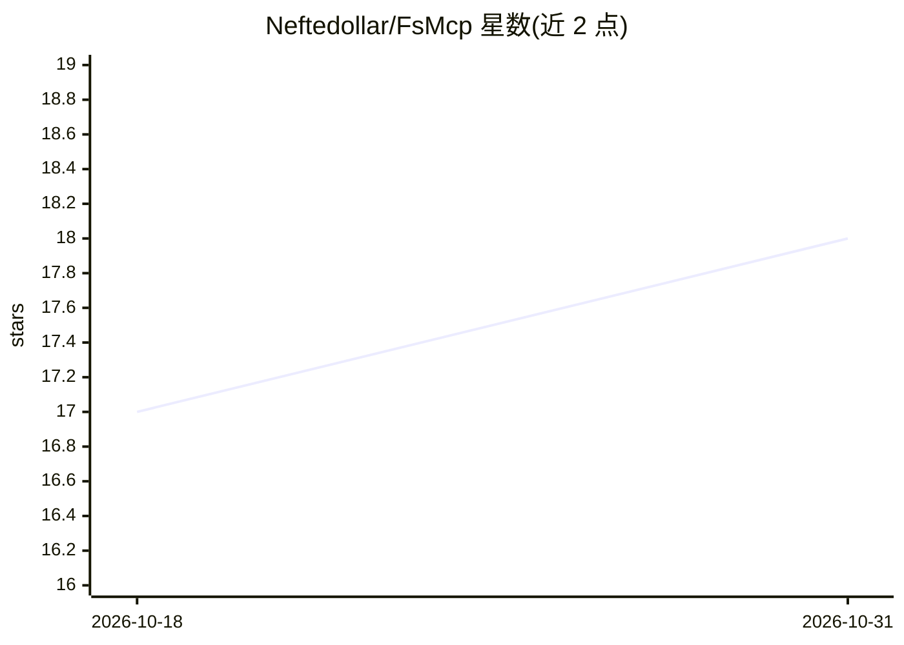

# Neftedollar/FsMcp

⭐ 18 · F# · MIT · 推送 2026-09-05 · [GitHub](https://github.com/Neftedollar/FsMcp) · 个人维护

**F# 构建 MCP 服务器与客户端的类型安全工具包**

基于 Microsoft ModelContextProtocol .NET SDK 封装的 F# 工具库，提供 mcpServer 计算表达式、TypedTool 类型化工具定义（TypeShape 自动生成 JSON Schema）、Result 错误处理、可取消处理器、ASP.NET Core HTTP 传输与企业授权（ID-JAG）客户端封装。以 7 个 NuGet 包分发（Server/Client/Testing/TaskApi/Sampling 等），面向用 F# 开发 MCP 服务器/客户端的开发者。SamplingTool 在 2.0 中刻意 fail-closed，旧传输路径未接通客户端。含 Expecto+FsCheck 测试套件与可运行示例。

## 筛选速览

| 维度 | 判定 | 备注 |
|---|---|---|
| AI 角色 | `ai-ecosystem` | LLM/agent 周边工具 |
| 许可风险 | `permissive` | MIT |
| 部署形态 | `None` |  |
| 模型依赖 | — | README 未给出锁定关系 |
| 硬件要求 | — | 无带数字的原话,不猜 |
| 安装摩擦 | `medium` | 含编译或系统依赖之一 |
| 成熟度 | — | 结构信号不足 |

## 能力要点

- mcpServer { } 计算表达式声明 tools/resources/prompts
- TypedTool.define<'T> 经 TypeShape 自动生成 JSON Schema
- Result<'T, McpError> 错误处理与协议取消令牌透传
- 企业级 ID-JAG 授权客户端封装（单飞令牌缓存、401 后受控刷新）

## 适用场景

- 用 F# 快速搭建类型安全的 MCP 服务器
- 编写类型化 MCP 客户端并接入企业授权
- 对 MCP 工具处理器做无网络的属性测试

## 场景标签

`Agent 框架` · 领域:Agent 开发

## 证据(README 行号)

> L3: **FsMcp is an idiomatic F# toolkit for building Model Context Protocol (MCP) servers and clients.** It wraps the off
> L30: - **`mcpServer { }` CE** — declare tools, resources, prompts in a single block

## 星数曲线

2026-10-18 17 → 2026-10-31 18（+1）

---
*卡片 v1 · prompt 1.4 · 生成 2026-10-30 · 置信度 high · 依据 README sha `5c5c8950ac31` · [字段定义](../../DATASET.md)*
