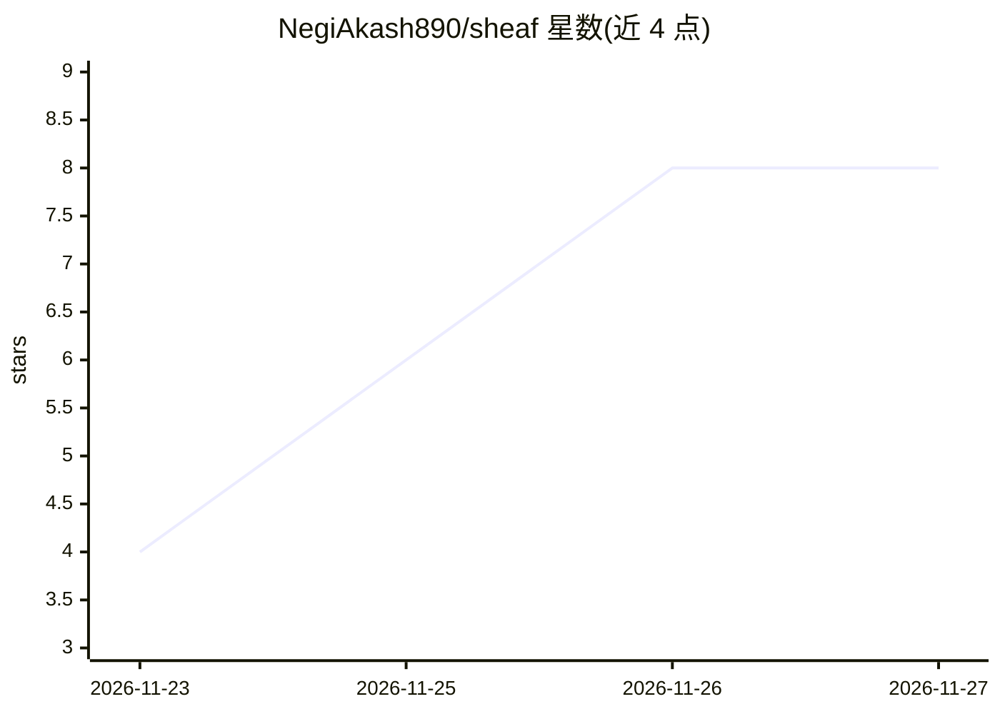

# NegiAkash890/sheaf

⭐ 8 · HTML · NOASSERTION · 推送 2026-11-26 · [GitHub](https://github.com/NegiAkash890/sheaf) · [官网](https://sheaf-site-nine-rouge.vercel.app/) · 个人维护

**本地 AI 整理 Mac 杂乱文件夹的桌面应用**

面向 Mac 用户的文件整理应用：读取文件内容（文本、PDF、Word、图片内文字），用本地运行的小模型将语义相近的文件分组为集合并命名，支持按人、地点、事物或想法搜索。所有移动需用户逐项确认、可一键撤销并附原因说明。无账号、无云端、无遥测，模型经本机 Ollama 运行。目前为未公开源码的未签名公测版，提供 DMG 安装包。

## 筛选速览

| 维度 | 判定 | 备注 |
|---|---|---|
| AI 角色 | `ai-enhanced` | 去掉 AI 部分产品仍成立 |
| 许可风险 | `none` | NOASSERTION |
| 部署形态 | `desktop` | 安装包/桌面程序 |
| 模型依赖 | local-ok | 支持本地模型 |
| 硬件要求 | — | 无带数字的原话,不猜 |
| 安装摩擦 | `low` | 无编译、无系统依赖或容器化 |
| 成熟度 | `idea` | |

## 能力要点

- 本地 AI 模型读取文件内容并按语义分组、命名集合
- 每次移动需用户批准，带日志可一键撤销
- 仅连接本机模型服务器，无账号/云/遥测
- 提供 Bigger（约2.1GB）与 Light（约1.25GB）两种模型可选

## 适用场景

- 整理杂乱的 Downloads 文件夹
- 按含义而非文件名查找文件
- 在不上传文件的前提下做本地内容整理

## 场景标签

 · 领域:文件管理/桌面工具

## 证据(README 行号)

> L5: **Messy folders, turned into tidy collections.** Sheaf is a free Mac app that reads what is inside your files, group
> L22: 2. **Sheaf reads it.** Small AI models on your Mac read text, PDFs, Word files and text inside images, link files t

## 星数曲线

2026-11-23 4 → 2026-11-27 8（+4）

---
*卡片 v1 · prompt 1.4 · 生成 2026-11-23 · 置信度 high · 依据 README sha `4329cbcc447a` · [字段定义](../../DATASET.md)*
