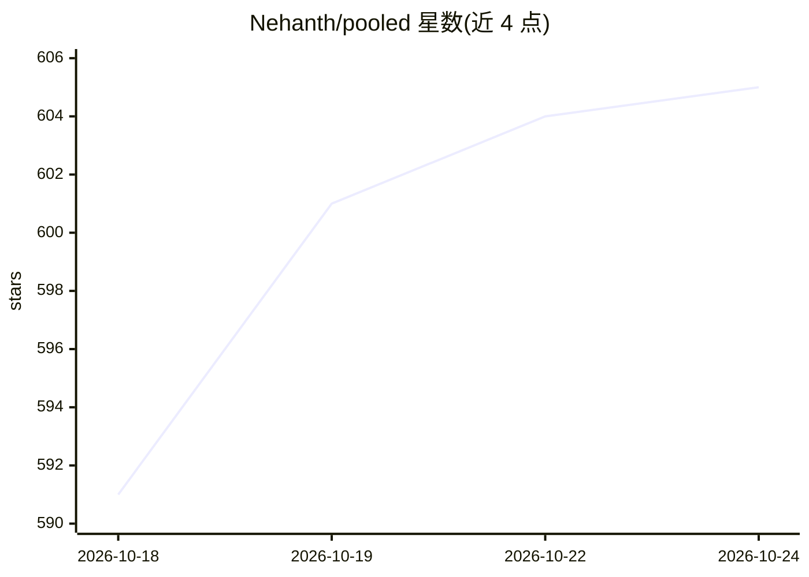

# Nehanth/pooled

⭐ 605 · JavaScript · MIT · 推送 2026-10-16 · [GitHub](https://github.com/Nehanth/pooled) · [官网](https://pooled.run) · 个人维护

**浏览器内多设备 P2P 联合推理运行大模型**

在浏览器标签页间以 P2P（WebRTC）方式联合运行开源大模型的推理运行时：房间内每台设备（笔记本/台式机/手机）持有模型部分层并在各自 GPU 上用自研 WGSL 内核计算，逐 token 传递 KB 级隐藏状态。支持 Qwen 27B/35B MoE/1.7B 及实验性 SSD 流式 125B Flash 模型、投机解码、Code mode（沙箱内构建并自修应用），并可经 OpenAI/Anthropic 兼容 API 服务外部工具（Codex CLI、Claude Code 等）。无需安装与账号，提供 npx CLI 与源码本地运行方式。

## 筛选速览

| 维度 | 判定 | 备注 |
|---|---|---|
| AI 角色 | `ai-ecosystem` | LLM/agent 周边工具 |
| 许可风险 | `permissive` | MIT |
| 部署形态 | `library` | 以包/库形式分发 |
| 模型依赖 | — | README 未给出锁定关系 |
| 硬件要求 | — | 无带数字的原话,不猜 |
| 安装摩擦 | `medium` | 含编译或系统依赖之一 |
| 成熟度 | `idea` | |

## 能力要点

- 多设备分层并行推理，token 级隐藏状态经 WebRTC 直连传递
- 自研 WGSL WebGPU 内核与投机解码（golden test 保证与朴素解码一致）
- 实验性 Qwen3.8 Flash：125B 模型大部分驻留 SSD、按需流式读入
- OpenAI / Anthropic 兼容 Serve API，接入 Codex CLI、Claude Code 等工具

## 适用场景

- 用家里的笔记本加手机凑显存跑 27B/35B 模型
- 在浏览器里让模型构建并修复小应用（Code mode）
- 把房间作为本地 OpenAI/Anthropic 兼容端点供编码 agent 使用

## 场景标签

`推理引擎` · 领域:训练与推理

## 证据(README 行号)

> L23: Pooled runs one open model across the devices in a room. Your laptop, a friend's desktop and a phone each hold some
> L27: Friends open one link. Each device (laptop, desktop, phone) holds some of the model's layers and runs them on its o
> L76: A room can serve its model to anything that speaks the OpenAI Chat Completions, OpenAI Responses or Anthropic Messa

## 星数曲线

2026-10-18 591 → 2026-10-24 605（+14）

---
*卡片 v1 · prompt 1.4 · 生成 2026-10-21 · 置信度 high · 依据 README sha `ff32bc37a401` · [字段定义](../../DATASET.md)*
