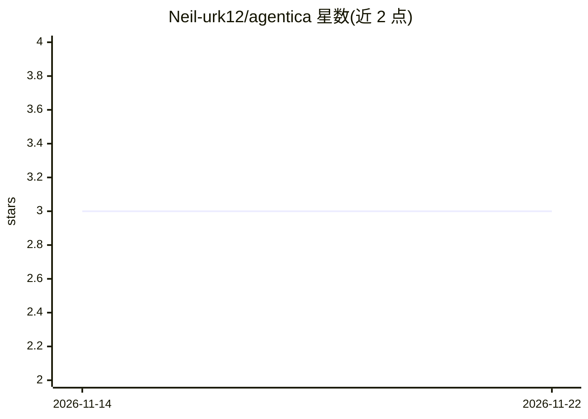

# Neil-urk12/agentica

⭐ 3 · Rust · MIT · 推送 2026-11-21 · [GitHub](https://github.com/Neil-urk12/agentica) · [官网](https://aagentica.pages.dev) · 个人维护

**本地桌面无限画布：与编码 agent 并排协作并审查变更**

基于 Tauri 的本地桌面应用（亦可浏览器模式连接本地 Axum 后端），以无限画布组织笔记、图形、项目文件夹、终端与 CLI 编码 agent 瓦片。模型对画布的编辑以提案形式到达，由用户应用或丢弃；变更通过 Git diff 审查并可将反馈回传 agent。无官方账号或服务器，用户自带模型供应商（OpenRouter 或任何 OpenAI 兼容端点）；语音输入由本机 Whisper 模型转录。部分功能标注为未验证，远程 MCP 写操作为计划项。

## 筛选速览

| 维度 | 判定 | 备注 |
|---|---|---|
| AI 角色 | `ai-ecosystem` | LLM/agent 周边工具 |
| 许可风险 | `permissive` | MIT |
| 部署形态 | `desktop` | 安装包/桌面程序 |
| 模型依赖 | locked-api |  |
| 硬件要求 | — | 无带数字的原话,不猜 |
| 安装摩擦 | `low` | 无编译、无系统依赖或容器化 |
| 成熟度 | `idea` | |

## 能力要点

- 无限画布组织文本、图形、项目文件夹、终端与 CLI agent 瓦片
- 模型编辑以提案到达，用户应用或丢弃，配合 Git diff 审查
- 通过 PATH 发现 Codex、Claude Code、OpenCode 等 CLI agent 并支持自定义
- 本地 Whisper 转录的语音输入与 MCP 只读工具

## 适用场景

- 在同一画布上并行运行多个编码 agent 并逐个审查其改动
- 让模型直接在画布上草图并手动确认落盘
- 自托管环境用自有 API key 驱动编码工作流

## 场景标签

`编码 Agent` `知识库管理` · 领域:编码与开发

## 证据(README 行号)

> L5: An infinite canvas for working with coding agents. Put notes, diagrams, project
> L9: Agentica runs locally as a desktop app (Tauri) or in your browser against a local
> L26: |Coding agents beyond Codex (Claude Code, OpenCode, Crush, pi, and more) found on `PATH`, plus custom agents|Implem

## 星数曲线

2026-11-14 3 → 2026-11-22 3（+0）

---
*卡片 v1 · prompt 1.4 · 生成 2026-11-22 · 置信度 mid · 依据 README sha `b3cc13a15e9d` · [字段定义](../../DATASET.md)*
