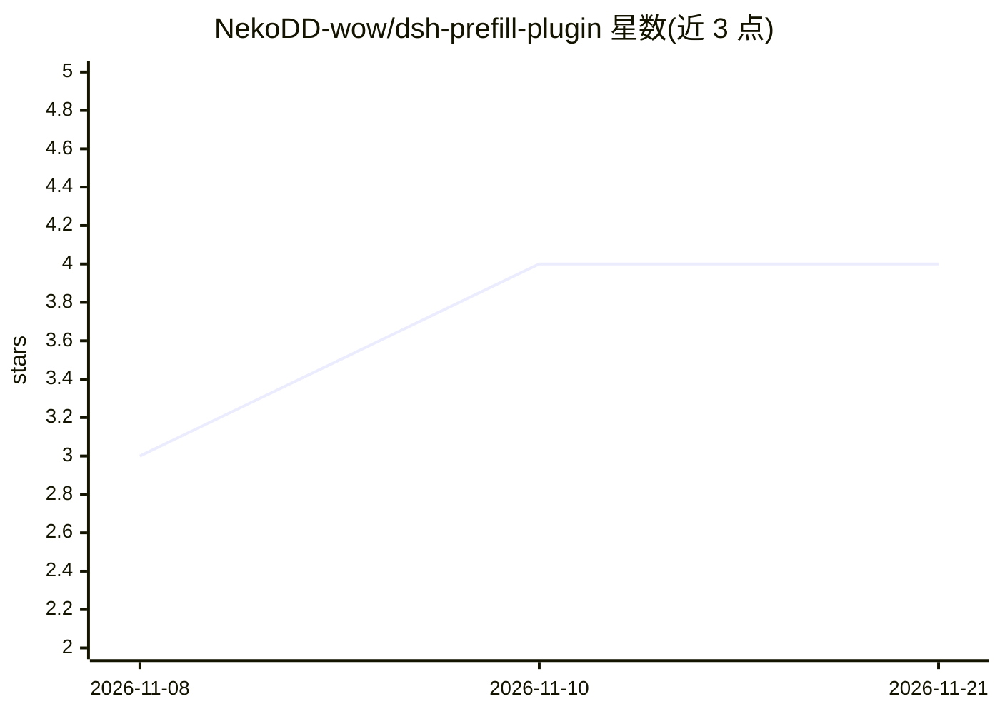

# NekoDD-wow/dsh-prefill-plugin

⭐ 4 · JavaScript · MIT · 推送 2026-11-14 · [GitHub](https://github.com/NekoDD-wow/dsh-prefill-plugin) · 个人维护 · 中文 README

**DSH Web 端预填装插件：管理系统提示、开场对话与每轮注入**

面向 DSH（DeepSeek Harness）Web 端的插件，在统一面板中管理会话前的上下文准备：改写系统提示（追加/替换/接管三种模式）、写开场对话、每轮注入提醒并支持规则化自动收放、导入 SillyTavern V2/V3 角色卡（JSON/PNG）、预设整体保存与套用。附带用量与缓存统计、未登记注入记录与阻断、思考前缀实验功能（默认关，仅官方 DeepSeek beta 上游验证，须流式请求且剥离 tools）。通过 git clone 后用 dsh plugin 命令安装，适配 DSH 0.2.x。

## 筛选速览

| 维度 | 判定 | 备注 |
|---|---|---|
| AI 角色 | `ai-ecosystem` | LLM/agent 周边工具 |
| 许可风险 | `permissive` | MIT |
| 部署形态 | `None` |  |
| 模型依赖 | — | README 未给出锁定关系 |
| 硬件要求 | — | 无带数字的原话,不猜 |
| 安装摩擦 | `low` | 无编译、无系统依赖或容器化 |
| 成熟度 | — | 结构信号不足 |

## 能力要点

- 系统提示三种模式（追加/替换正文·保留工具/接管），每项可单独停用但保留内容
- 每轮注入自动收放：按离线规则打分的状态机（试停/暂停/恢复）
- 导入并编译 SillyTavern 角色卡（V2/V3 JSON/PNG），支持世界书与故事记忆
- 预设整体保存/套用，可从当前会话取材生成开场对话

## 适用场景

- 在 DSH 会话里切换人格预设或套角色卡进行角色扮演
- 控制模型思维链的语言与格式（中文思考、四段式等）
- 把聊到一半的会话存成预设，之后从该走向接着开新会话
- 降低长会话的每轮输入与 token 开销（接管/纯净模式）

## 场景标签

`聊天机器人` `提示工程` · 领域:Agent 开发

## 证据(README 行号)

> L3: DSH（DeepSeek Harness）Web 端「预填装」插件：在会话开始前替模型"准备好"它该知道的东西 —— 换系统提示、写开场对话、每轮注入提醒、套角色卡，都在同一个面板里；每项都能**单独停用但保留内容**。
> L26: ## 安装
> L30: dsh plugin --profile web add /clone 下来的绝对路径/dsh-prefill-plugin

## 星数曲线

2026-11-08 3 → 2026-11-21 4（+1）

---
*卡片 v1 · prompt 1.4 · 生成 2026-11-21 · 置信度 high · 依据 README sha `ffdd3e2e69db` · [字段定义](../../DATASET.md)*
