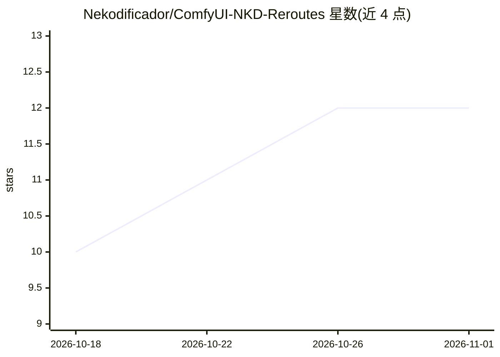

# Nekodificador/ComfyUI-NKD-Reroutes

⭐ 12 · JavaScript · GPL-3.0 · 推送 2026-10-29 · [GitHub](https://github.com/Nekodificador/ComfyUI-NKD-Reroutes) · 个人维护

**ComfyUI 连线样式与节点吸附整理扩展**

安装到 ComfyUI custom_nodes 的节点编辑器美化扩展：提供 Blender 风格 Bézier 平滑连线与直角 PCB 走线两种绘制方式，附带曲线细节、转角圆角、节点避让等参数；另含 Shift 拖拽磁吸功能，按列/行/直线缆等六种规则将节点对齐到邻节点，并以半透明 ghost 预览落点。所有设置可在 NKD Wires 侧边栏实时调节并保存为预设，兼容经典画布与 Nodes 2.0。PCB 走线引擎复用 comfyui-cable-management 的 MIT 代码。

## 筛选速览

| 维度 | 判定 | 备注 |
|---|---|---|
| AI 角色 | `ai-ecosystem` | LLM/agent 周边工具 |
| 许可风险 | `viral` | GPL-3.0 |
| 部署形态 | `None` |  |
| 模型依赖 | — | README 未给出锁定关系 |
| 硬件要求 | — | 无带数字的原话,不猜 |
| 安装摩擦 | `low` | 无编译、无系统依赖或容器化 |
| 成熟度 | — | 结构信号不足 |

## 能力要点

- Bézier 平滑连线与直角 PCB 走线两种模式
- 20+ 曲线/走线参数可实时调节并保存预设
- Shift 拖拽磁吸：六种对齐规则 + ghost 预览与虚线参考线
- 兼容经典画布与 Nodes 2.0

## 适用场景

- 整理大型 ComfyUI 工作流的连线走向
- 让节点按列/行自动对齐排布
- 自定义连线视觉风格并保存预设

## 场景标签

 · 领域:AI 工作流工具/UI 扩展

## 证据(README 行号)

> L3: Wires and layout for ComfyUI. Two ways to draw your connections — smooth Bézier curves in the
> L17: 1. Clone or copy this folder into your `ComfyUI/custom_nodes/` directory.

## 星数曲线

2026-10-18 10 → 2026-11-01 12（+2）

---
*卡片 v1 · prompt 1.4 · 生成 2026-11-01 · 置信度 high · 依据 README sha `0f09446c4ed5` · [字段定义](../../DATASET.md)*
