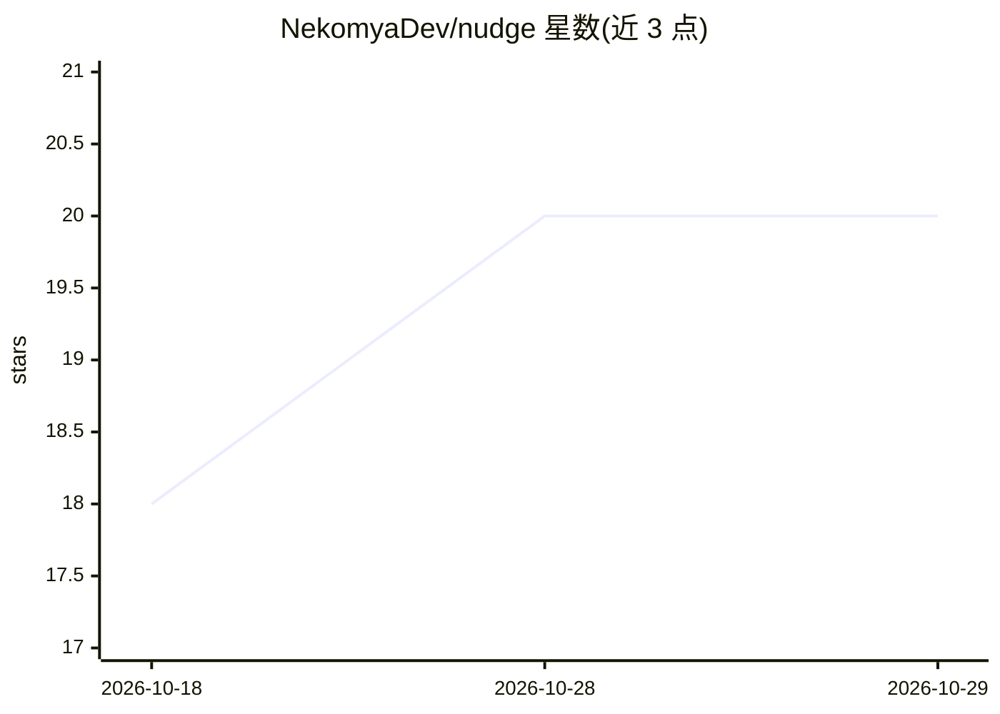

# NekomyaDev/nudge

⭐ 20 · Rust · Apache-2.0 · 推送 2026-10-28 · [GitHub](https://github.com/NekomyaDev/nudge) · [官网](https://github.com/NekomyaDev/nudge) · 组织维护 · 中文 README

**面向 LLM agent 的类型化、可重放、预算约束编程语言**

一种编译型 DSL：为编写 AI agent 提供静态类型（LLM 输出 schema 为一等类型）、编译期效应检查（14 种效应需在函数签名声明）、内容寻址 NTF 确定性 trace（可 $0 重放、CI 回归）、编译器与运行时共同强制执行的预算契约，以及 par/race 并发原语。可编译到 Python 与 TypeScript，提供原生字节码 VM、沙箱化工作区、持久 KV store、本地 UI 与 fail-closed 进程/认证管控。面向构建生产级 agent 的开发者，通过一键脚本、Snap、Docker 或预编译二进制安装。

## 筛选速览

| 维度 | 判定 | 备注 |
|---|---|---|
| AI 角色 | `ai-ecosystem` | LLM/agent 周边工具 |
| 许可风险 | `permissive` | Apache-2.0 |
| 部署形态 | `desktop` | 安装包/桌面程序 |
| 模型依赖 | local-ok | 支持本地模型 |
| 硬件要求 | — | 无带数字的原话,不猜 |
| 安装摩擦 | `low` | 无编译、无系统依赖或容器化 |
| 成熟度 | — | 结构信号不足 |

## 能力要点

- LLM 输出 schema 为编译期类型，违规自动修复
- 每次运行写入可 diff、可提交、$0 重放的确定性 NTF trace
- 预算为编译器与运行时强制执行的硬契约
- 编译到 Python/TypeScript，含原生字节码 VM 与单二进制打包

## 适用场景

- 用带类型与回归测试的语言构建生产级 LLM agent
- 通过 trace 重放在 CI 中做 agent 回归测试
- 在现有 Python/TypeScript 服务中部署编译后的 agent

## 场景标签

`Agent 框架` · 领域:Agent 开发

## 证据(README 行号)

> L6:  A typed, replayable, budget-aware programming language for AI agents.
> L29: Production agents are still held together with glue code: prompt chains parsed by hand, tool calls wrapped in try/e
> L35: |No regression testing|Record and replay bolted on|Every run writes an NTF trace, and every trace is a deterministi

## 星数曲线

2026-10-18 18 → 2026-10-29 20（+2）

---
*卡片 v1 · prompt 1.4 · 生成 2026-10-28 · 置信度 mid · 依据 README sha `79e40c03386c` · [字段定义](../../DATASET.md)*
