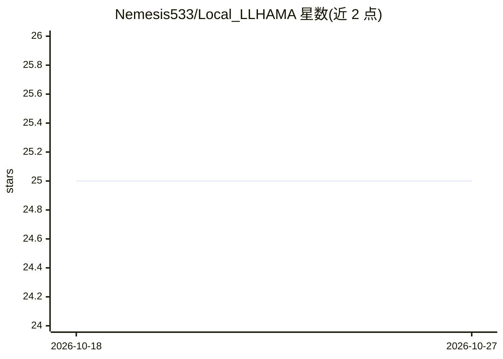

# Nemesis533/Local_LLHAMA

⭐ 25 · Python · NOASSERTION · 推送 2026-04-03 · [GitHub](https://github.com/Nemesis533/Local_LLHAMA) · 个人维护

**智能家居离线 LLM 语音/聊天编排中间件（Home Assistant + Ollama）**

位于 Home Assistant 与 Ollama 之间的编排中间件：将自然语言多意图指令分解为并行任务，路由到 Home Assistant API、PostgreSQL 日历、天气/新闻等后端，通过自适应上下文缩放与多轮提示工程让 8-20B 参数模型在 8-24GB VRAM 消费级硬件上运行。提供语音（OpenWakeWord + Whisper + Piper）与 WebSocket 聊天双通道、模糊设备名匹配、6+ 语言支持、基于 Ollama embedding 的语义记忆搜索及 Web 管理界面。完全离线运行，需 Python 3.10+、PostgreSQL、Ollama 与 Home Assistant，Linux 环境下通过安装脚本部署。

## 筛选速览

| 维度 | 判定 | 备注 |
|---|---|---|
| AI 角色 | `ai-ecosystem` | LLM/agent 周边工具 |
| 许可风险 | `none` | NOASSERTION |
| 部署形态 | `library` | 以包/库形式分发 |
| 模型依赖 | local-ok | 支持本地模型 |
| 硬件要求 | `gpu-24g` | |
| 安装摩擦 | `medium` | 含编译或系统依赖之一 |
| 成熟度 | — | 结构信号不足 |

## 能力要点

- 多意图并行分解与多后端路由（单句可触发 6+ 独立操作）
- 语音与聊天双通道，Whisper 语音识别 + Piper TTS
- 8GB-32GB VRAM 硬件验证预设（Qwen2.5 / GPT-OSS 等模型组合）
- 完全离线运行，无云 API、无遥测

## 适用场景

- 在消费级 GPU 上用小模型驱动智能家居语音/聊天助手
- 一句话同时控制多个设备并设置日程、查询天气
- 家庭局域网内搭建多用户、多语言的离线 AI 助手

## 场景标签

`AI 助手` `工作流自动化` · 领域:效率与自动化

## 证据(README 行号)

> L8: **Local_LLAMA** is anorchestration middleware that sits between Home Assistant and Ollama, enabling smaller LLM mode
> L145: - **Ollama Server**: Local or remote for LLM inference

## 星数曲线

2026-10-18 25 → 2026-10-27 25（+0）

---
*卡片 v1 · prompt 1.4 · 生成 2026-10-27 · 置信度 high · 依据 README sha `2691950bb4be` · [字段定义](../../DATASET.md)*
