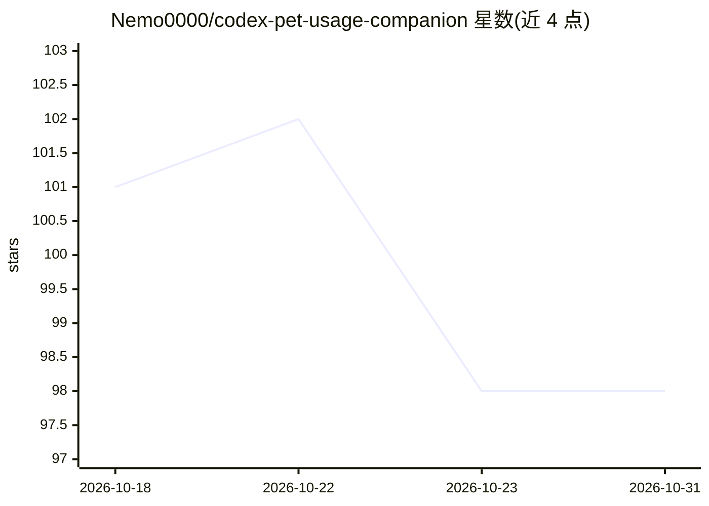

# Nemo0000/codex-pet-usage-companion

⭐ 98 · TypeScript · MIT · 推送 2026-09-02 · [GitHub](https://github.com/Nemo0000/codex-pet-usage-companion) · 个人维护 · 中文 README

**Windows 托盘工具：切换 Codex 宠物并查看 ChatGPT 用量限额**

本地优先的 Windows 托盘应用，面向 Codex（ChatGPT 订阅）用户，把两件事合并到一个面板：读取订阅速率限制窗口、重置倒计时与本地 24 小时/7 天趋势（只读、七天后过期、可清除），以及发现/安装/切换 Petdex 社区宠物包，并含逐帧检查与模板导出的 Pet Workshop。机制上通过本地 `codex app-server` 的 stdio 传输通信，不抓取网页或读取浏览器 cookie；宠物切换依赖可见的 Windows UI Automation，失败时保留安装结果并提示手动选择。要求 Windows 10/11 x64、WebView2、Codex CLI 与 ChatGPT 登录。

## 筛选速览

| 维度 | 判定 | 备注 |
|---|---|---|
| AI 角色 | `ai-ecosystem` | LLM/agent 周边工具 |
| 许可风险 | `permissive` | MIT |
| 部署形态 | `desktop` | 安装包/桌面程序 |
| 模型依赖 | — | README 未给出锁定关系 |
| 硬件要求 | — | 无带数字的原话,不猜 |
| 安装摩擦 | `low` | 无编译、无系统依赖或容器化 |
| 成熟度 | — | 结构信号不足 |

## 能力要点

- 通过本地 codex app-server stdio 读取用量限额，数据不离开设备
- Petdex 社区宠物库：搜索、安装、修复、卸载、切换与本地 ZIP/文件夹导入
- Pet Workshop：逐帧检查动画、元数据编辑、安全 ZIP 导出与 v1/v2 创作模板
- 版本化设置备份、CSV/JSON 用量导出、英/简中/日三语界面

## 适用场景

- 在托盘面板随时查看 Codex 剩余额度与重置倒计时
- 浏览并一键安装切换 Petdex 社区宠物
- 自制宠物包并用 Pet Workshop 检查帧后分享

## 场景标签

 · 领域:开发者工具/AI 服务配套

## 证据(README 行号)

> L44: The app launches `codex app-server` locally and communicates over its stable `stdio` transport. It does not scrape 
> L30: Codex users often need two separate workflows: check subscription rate limits and open the official Pets settings t

## 星数曲线

2026-10-18 101 → 2026-10-31 98（-3）

---
*卡片 v1 · prompt 1.4 · 生成 2026-10-23 · 置信度 high · 依据 README sha `d727a84627b6` · [字段定义](../../DATASET.md)*
