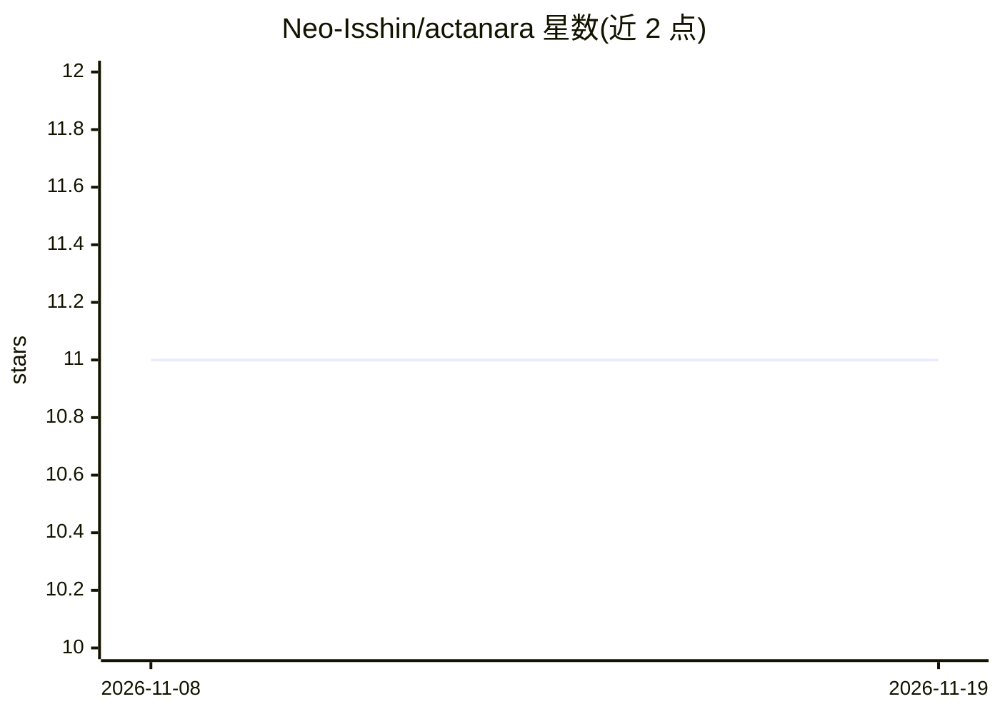

# Neo-Isshin/actanara

⭐ 11 · Python · MIT · 推送 2026-09-28 · [GitHub](https://github.com/Neo-Isshin/actanara) · [官网](https://neo-isshin.github.io/actanara/) · 个人维护 · 中文 README

**为多 Agent 运行时会话做本地持久化记忆与任务图管理**

Actanara 读取本地多个 Agent 运行时（Claude Code、Cursor、Codex、Gemini CLI 等 15+ 种）的会话与日志，将其整理为本地事实数据库，提供四项机制：自动从聊天、diff 与工具调用中抽取层级任务树（Nova-Task）；跨 Agent 记忆检索（默认 SQLite FTS5 词法索引，可选 nova-RAG 语义检索，RAG 对外部 Agent 仅只读）；已验证任务成果与可复用技能的本地资产库；生成日/周/月工作记录的 Dashboard。数据（SQLite、Markdown、向量索引）全部保留在本地磁盘。提供 macOS/Linux 官方安装脚本，Linux 验证于 Debian x86_64。

## 筛选速览

| 维度 | 判定 | 备注 |
|---|---|---|
| AI 角色 | `ai-ecosystem` | LLM/agent 周边工具 |
| 许可风险 | `permissive` | MIT |
| 部署形态 | `desktop` | 安装包/桌面程序 |
| 模型依赖 | — | README 未给出锁定关系 |
| 硬件要求 | `cpu-ok` | |
| 安装摩擦 | `low` | 无编译、无系统依赖或容器化 |
| 成熟度 | — | 结构信号不足 |

## 能力要点

- 聚合 15+ 种 Agent 运行时的本地会话与日志
- 跨 Agent 共享记忆：词法兜底（SQLite FTS5）+ 可选 CPU-only 本地嵌入 RAG
- nova-RAG 对外部 Agent 实行只读查询边界
- 自动生成日/周/月工作记录与本地知识资产库

## 适用场景

- 多个 AI 编码工具之间延续先前会话的决策与调试证据
- 从 Agent 聊天记录自动重建站会笔记、工单与变更记录
- 在无头服务器上通过 SSH 端口转发访问本地 Dashboard

## 场景标签

`Agent 记忆` `知识库管理` `RAG` · 领域:Agent 开发

## 证据(README 行号)

> L7:  Consolidate sessions, tasks, and debugging evidence across Claude Code, Cursor, Codex, Gemini CLI, Antigravity, ZCo
> L38: **Actanara solves this**: It quietly ingests and normalizes telemetry across all your local Agent Runtimes, distill
> L52:  │       Supported 15+ Agent Runtimes (Local Sessions & Logs)      │

## 星数曲线

2026-11-08 11 → 2026-11-19 11（+0）

---
*卡片 v1 · prompt 1.4 · 生成 2026-11-19 · 置信度 mid · 依据 README sha `33fb42f68a8d` · [字段定义](../../DATASET.md)*
