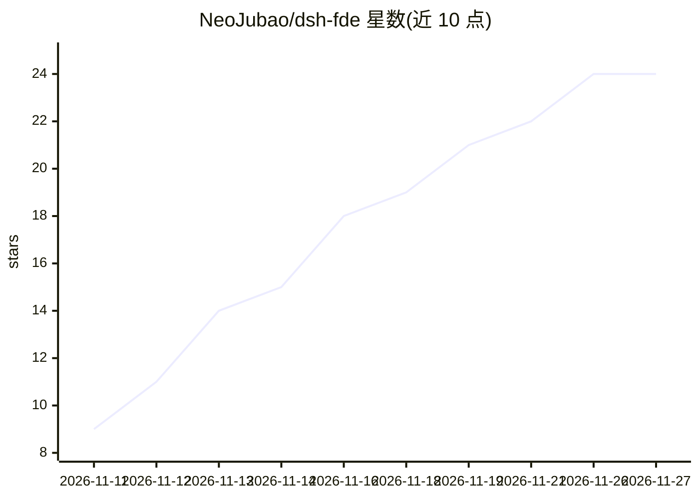

# NeoJubao/dsh-fde

⭐ 24 · JavaScript · NOASSERTION · 推送 2026-11-23 · [GitHub](https://github.com/NeoJubao/dsh-fde) · 个人维护 · 中文 README

**DSH 插件：客户全生命周期看板、8 阶段门禁与 FDE 方法库**

面向 FDE/解决方案/售前角色的 DeepSeek Harness（DSH）插件，把客户经营做成中文界面的工作站面板：客户沿 8 阶段（线索→采用）推进且阶段间有门禁（agent 不能自行过门禁）、任务 5 泳道看板、今日注意力汇总、按阶段模板发起会话并由 agent 通过 fde_* 工具回报。内置 8 篇方法、16 个技能与资料库、招采关联。纯 JS，运行时依赖为零；客户数据只在本机工作区。明确边界：不是 CRM、不做多 agent 调度、不自动推进阶段或对外发送。

## 筛选速览

| 维度 | 判定 | 备注 |
|---|---|---|
| AI 角色 | `ai-ecosystem` | LLM/agent 周边工具 |
| 许可风险 | `permissive` | NOASSERTION |
| 部署形态 | `None` |  |
| 模型依赖 | locked-api |  |
| 硬件要求 | — | 无带数字的原话,不猜 |
| 安装摩擦 | `low` | 无编译、无系统依赖或容器化 |
| 成熟度 | `idea` | |

## 能力要点

- 客户 8 阶段看板与门禁（产物自动检查 + 人工确认，agent 不能自行过门禁）
- 11 个 fde_* 编排工具 + 16 个技能（方法随包分发可离线读）
- 零运行时依赖，客户数据仅存本机工作区，唯一可选外联需显式授权
- 场景评估与成本报价两个可复算工具（fde_scenario / fde_quote）

## 适用场景

- 管理多个客户的推进状态：今天该推谁、卡在哪、缺什么材料
- 用看板与门禁约束 agent 会话，人工审核后过阶段
- FDE 售前过程中查阅方法库、资料库与招采信息

## 场景标签

 · 领域:销售/客户经营工具

## 证据(README 行号)

> L6: > 跑在 DeepSeek Harness（DSH）里，中文界面，纯 JS，零运行时依赖。
> L13: - **客户（engagement）** 沿 **8 个阶段**推进：线索 → 研判 → 会面 → **场景** → 方案 → 试点 → 交付 → 采用；阶段间有**门禁**（产物自动检查 + 人工确认），**agent 不能自行
> L73: |FDE 编排工具（11）|`fde_board` · `fde_engagement` · `fde_item` · `fde_attention` · `fde_brief` · `fde_harvest` · `fde_bi

## 星数曲线

2026-11-11 9 → 2026-11-27 24（+15）

---
*卡片 v1 · prompt 1.4 · 生成 2026-11-18 · 置信度 high · 依据 README sha `465cc48e1546` · [字段定义](../../DATASET.md)*
