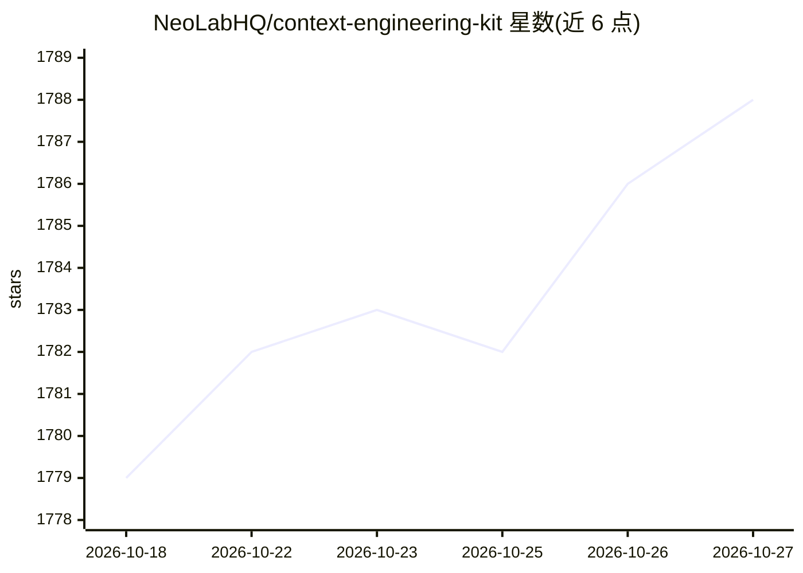

# NeoLabHQ/context-engineering-kit

⭐ 1,788 · TypeScript · GPL-3.0 · 推送 2026-08-26 · [GitHub](https://github.com/NeoLabHQ/context-engineering-kit) · [官网](https://neolab.gitbook.io/cek) · 组织维护

**面向 Claude Code 等编程 agent 的上下文工程插件集，提升 agent 输出质量**

由 NeoLabHQ 维护的插件市场（marketplace），收录一组上下文工程技术与模式：反射循环、规格驱动开发、子代理驱动开发、代码审查、TDD 等插件，以命令、子代理和 skills 形式注入编程 agent 的上下文，目标是提高 agent 结果质量与可预测性并控制 token 占用。支持 Claude Code 原生插件机制，也可通过 npx skills / openskills 安装到 Cursor、Codex、OpenCode、Gemini CLI、Antigravity 等。其中 Review 插件自称 CodeRabbit 的开源替代。含基于论文（Self-Refine、Reflexion、Agentic Context Engineering）的技术来源说明。

## 筛选速览

| 维度 | 判定 | 备注 |
|---|---|---|
| AI 角色 | `ai-ecosystem` | LLM/agent 周边工具 |
| 许可风险 | `viral` | GPL-3.0 |
| 部署形态 | `library` | 以包/库形式分发 |
| 模型依赖 | — | README 未给出锁定关系 |
| 硬件要求 | — | 无带数字的原话,不猜 |
| 安装摩擦 | `low` | 无编译、无系统依赖或容器化 |
| 成熟度 | — | 结构信号不足 |

## 能力要点

- 插件市场形式，按需安装单个插件，各插件只加载自身 agents/commands/skills
- 基于 agentskills.io 规范，SDD 插件基于 Arc42 文档规范
- 提供 /reflect、/do-and-judge、/plan-task 等命令与自动反射 hooks
- 附带各 agent 使用方式的准确率/token 开销对照表（基于生产项目使用）

## 适用场景

- 给 Claude Code 增加规格驱动开发与子代理审查能力
- 通过 /reflect 等命令降低 agent 输出中的幻觉与遗漏
- 用开源 Review 插件替代 CodeRabbit 做代码/PR 审查
- 在 Cursor/OpenCode/Gemini CLI 等工具中复用同一套 skills

## 场景标签

`代码审查` `提示工程` · 领域:Agent 开发

## 证据(README 行号)

> L13: A hand-crafted collection of advanced context engineering techniques and patterns with minimal token footprint, foc
> L15: The marketplace is based on prompts our company's developers have used daily for a long time, supplemented by plugi

## 星数曲线

2026-10-18 1,779 → 2026-10-27 1,788（+9）

---
*卡片 v1 · prompt 1.4 · 生成 2026-10-21 · 置信度 high · 依据 README sha `24dca7630c94` · [字段定义](../../DATASET.md)*
