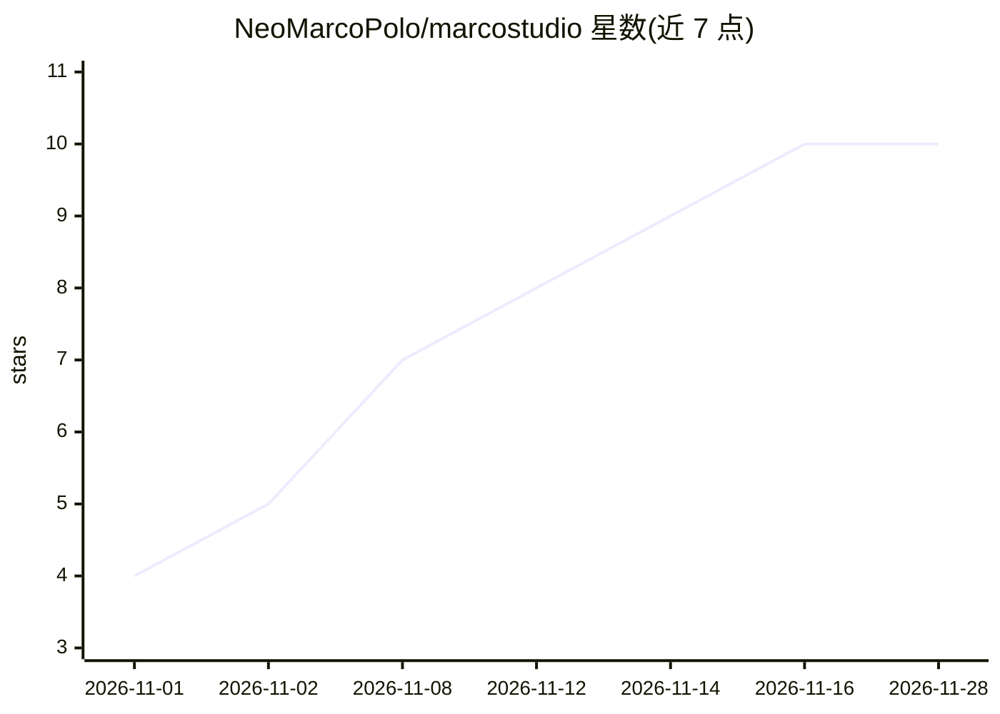

# NeoMarcoPolo/marcostudio

⭐ 10 · Python · MIT · 推送 2026-11-11 · [GitHub](https://github.com/NeoMarcoPolo/marcostudio) · [官网](https://neomarcopolo.co/marcostudio/) · 组织维护

**13 个图像/视频创作工具，配合本地 ComfyUI 与开放权重模型生成**

MarcoStudio 提供一个网页界面与一组 ComfyUI 工作流，覆盖重打光、换装、去背景、产品场景合成、视频生成与动画等 13 个工具，图像端使用 Qwen Image 系列检查点，视频端使用 MiniMax H3 检查点。前端连接用户自己的 ComfyUI 执行生成，浏览器直连、无中转服务器；可选 Python 应用（Windows）提供本地 API、文件存储与任务历史，依赖 FFmpeg/FFprobe。项目处于 alpha 阶段，未给出最低 VRAM 要求，全部模型文件约 197.3 GB。

## 筛选速览

| 维度 | 判定 | 备注 |
|---|---|---|
| AI 角色 | `ai-native` | 本体是模型或模型工具 |
| 许可风险 | `permissive` | MIT |
| 部署形态 | `desktop` | 安装包/桌面程序 |
| 模型依赖 | — | README 未给出锁定关系 |
| 硬件要求 | — | 无带数字的原话,不猜 |
| 安装摩擦 | `medium` | 含编译或系统依赖之一 |
| 成熟度 | `idea` | |

## 能力要点

- 13 个图像/视频工具，分 Standard/Flash 两种模式，按需下载模型
- 浏览器直连本地 ComfyUI，媒体不经 MarcoStudio 服务器
- 通过 ComfyUI-Manager 4 自动下载模型与校验文件大小
- 提供托管页面与本地前端（Node）/Python 应用三种运行方式

## 适用场景

- 用自己的 GPU 与开放权重模型重打光或换装人像照片
- 从产品图与提示词生成商品场景图
- 生成视频或从首帧动画化图像，无需云端积分账号

## 场景标签

`图像生成` `视频生成` · 领域:内容生成

## 证据(README 行号)

> L3: Relight photos, change outfits, remove backgrounds, and make videos with your own ComfyUI.
> L14: **ComfyUI must be installed and running on your computer.** MarcoStudio supplies the interface and workflows; your 
> L28: |Relight|Photo + light controls|Qwen Image Edit 2509 + Relight|Flash|

## 星数曲线

2026-11-01 4 → 2026-11-28 10（+6）

---
*卡片 v1 · prompt 1.4 · 生成 2026-11-20 · 置信度 high · 依据 README sha `954342dab8ea` · [字段定义](../../DATASET.md)*
