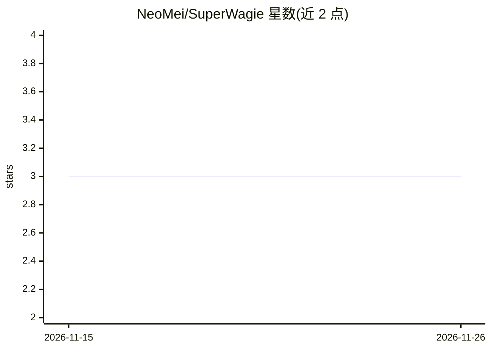

# NeoMei/SuperWagie

⭐ 3 · JavaScript · Apache-2.0 · 推送 2026-11-25 · [GitHub](https://github.com/NeoMei/SuperWagie) · [官网](https://www.superwagie.com/) · 个人维护 · 中文 README

**面向办公与编程的本地 AI 工作台，支持文档与 PPT 生成**

SuperWagie 是面向 macOS 和 Windows 的本地 AI 工作台，基于 OpenChamber 定制分支、用 OpenCode 作为智能体内核。功能覆盖 Markdown 任务管理、本地资料库检索、文档与 PPT 制作，以及可读写文件、运行命令与测试的编程智能体。采用自带模型 API Key 的方式接入用户配置的模型服务；任务文件、资料库索引与模型 Key 保存在本机。常规发布提供 macOS arm64 与 Windows x64 安装包，自更新关闭、需手动升级。

## 筛选速览

| 维度 | 判定 | 备注 |
|---|---|---|
| AI 角色 | `ai-native` | 本体是模型或模型工具 |
| 许可风险 | `permissive` | Apache-2.0 |
| 部署形态 | `desktop` | 安装包/桌面程序 |
| 模型依赖 | — | README 未给出锁定关系 |
| 硬件要求 | — | 无带数字的原话,不猜 |
| 安装摩擦 | `low` | 无编译、无系统依赖或容器化 |
| 成熟度 | — | 结构信号不足 |

## 能力要点

- 基于 OpenCode 内核的编程智能体，可读写文件、运行命令与测试
- 任务以 Markdown 文件保存，可放进版本库并检测外部修改
- 内置 SuperPPT/SuperWriter/SuperVideo 等技能，装入 OpenCode 技能目录
- 任务、资料库索引和模型 Key 保存在本机（local-first）

## 适用场景

- 管理 Markdown 任务并驱动智能体完成编程工作
- 从本地资料库检索内容生成文档和 PPT
- 在 macOS/Windows 桌面本地运行 AI 办公会话

## 场景标签

`编码 Agent` `AI 写作` `AI 助手` · 领域:编码与开发

## 证据(README 行号)

> L3: 犇马 SuperWagie 是面向 macOS 和 Windows 的本地 AI 工作台，支持办公任务和编程。可以管理 Markdown 任务、检索本地资料库、制作文档和 PPT，也可以阅读代码、修改文件、运行命令和测试。它基于 O
> L9: SuperWagie, named 犇马 in Chinese, is a local AI workbench for office work and coding on macOS and Windows. It combine
> L38: 首次启动时，应用会把下面这些技能装进 OpenCode 的技能目录（`~/.config/opencode/skills`）；同名技能已经存在（包括 `~/.claude/skills`、`~/.agents/skills` 里的

## 星数曲线

2026-11-15 3 → 2026-11-26 3（+0）

---
*卡片 v1 · prompt 1.4 · 生成 2026-11-22 · 置信度 high · 依据 README sha `dfae30572778` · [字段定义](../../DATASET.md)*
