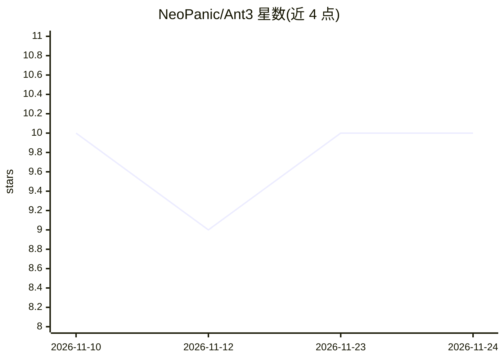

# NeoPanic/Ant3

⭐ 10 · Rust · MIT · 推送 2026-11-22 · [GitHub](https://github.com/NeoPanic/Ant3) · 个人维护 · 中文 README

**用信息素协同机制自组织的多智能体 Rust 平台**

以 Rust 编写的多智能体平台，参考蚁群行为实现同伴 agent 的自组织：agent 通过信息素式痕迹字段（30 分钟半衰期蒸发）、响应阈值分工、CAS 冲突裁决与能量预算机制在共享任务板上认领、拆分与复用任务，无固定角色流水线。提供本地优先的单二进制部署与 Web 控制台（任务板/成果库/待人工处理收件箱），模型/工具循环可作为独立 crate 使用，内置对比单 agent 与集群效果的评测工具。

## 筛选速览

| 维度 | 判定 | 备注 |
|---|---|---|
| AI 角色 | `ai-ecosystem` | LLM/agent 周边工具 |
| 许可风险 | `permissive` | MIT |
| 部署形态 | `None` |  |
| 模型依赖 | — | README 未给出锁定关系 |
| 硬件要求 | — | 无带数字的原话,不猜 |
| 安装摩擦 | `low` | 无编译、无系统依赖或容器化 |
| 成熟度 | `idea` | |

## 能力要点

- 信息素痕迹字段：30 分钟半衰期蒸发，成功路径吸引工作
- 无固定角色：分工与招募从局部规则涌现，可选自选任务模式
- 内置评测 harness：同任务同预算下单 agent 对比集群
- 模型/工具循环为独立 crate，可脱离平台使用

## 适用场景

- 在可信本地环境中让多个 agent 自组织完成可验收的任务
- 研究对比单 agent 与集群协作在同一任务上的表现
- 通过控制台观察并复盘集群的协作与收敛过程

## 场景标签

`多智能体` `Agent 框架` `模型评测` · 领域:Agent 开发

## 证据(README 行号)

> L14: **Ant³ is a multi-agent platform where peer AI agents self-organize like an ant colony.** Publish a task with accep
> L31: The result is a local-first, single-binary Rust platform you can run, inspect, and extend — with the model/tool loo
> L65: Ant³ speaks **OpenAI-compatible Chat Completions**, **OpenAI Responses**, and **Anthropic Messages**. Configuration

## 星数曲线

2026-11-10 10 → 2026-11-24 10（+0）

---
*卡片 v1 · prompt 1.4 · 生成 2026-11-20 · 置信度 high · 依据 README sha `1132a3001746` · [字段定义](../../DATASET.md)*
