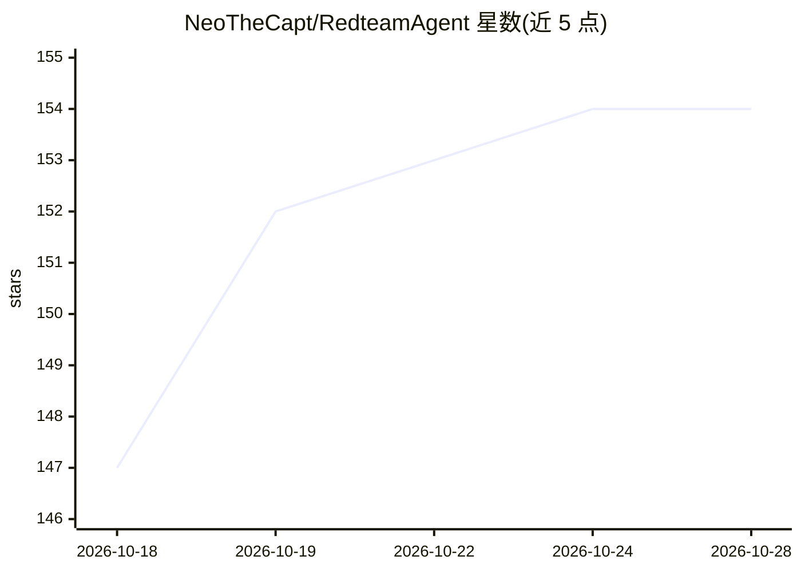

# NeoTheCapt/RedteamAgent

⭐ 154 · Python · 推送 2026-08-02 · [GitHub](https://github.com/NeoTheCapt/RedteamAgent) · [官网](https://github.com/NeoTheCapt/RedteamAgent#quick-start) · 个人维护 · 中文 README

**面向授权实验环境的自动化 AI 红队渗透测试 agent**

将 Claude Code、OpenCode、Codex 三种 AI CLI 工作区改造为渗透测试环境的自主红队 agent：内置 8 个专用 agent（操作员、侦察、漏洞分析、漏洞利用开发、模糊测试、OSINT 等），按 5 阶段方法论（侦察→收集→测试→利用+OSINT→报告）运行；所有渗透工具在 Docker 中容器化运行（Kali 工具箱、mitmproxy、Katana、可选 Metasploit RPC），并以 SQLite 队列支撑可中断恢复的任务流水线。提供本地 Web 编排 GUI，附 79 个 OWASP 等安全参考文件。不支持原生 Windows/PowerShell。

## 筛选速览

| 维度 | 判定 | 备注 |
|---|---|---|
| AI 角色 | `ai-native` | 本体是模型或模型工具 |
| 许可风险 | `none` | — |
| 部署形态 | `self-host` | docker 或自建部署 |
| 模型依赖 | locked-api |  |
| 硬件要求 | — | 无带数字的原话,不猜 |
| 安装摩擦 | `low` | 无编译、无系统依赖或容器化 |
| 成熟度 | — | 结构信号不足 |

## 能力要点

- 8 个专用 agent 组成的 5 阶段自主渗透工作流
- 渗透工具全部 Docker 容器化，无需本地安装
- SQLite 队列任务流水线与中断恢复（/resume）
- 本地 Web 编排 GUI 管理多工作区与实时运行

## 适用场景

- 在授权的 CTF/实验环境对 Web 目标做半自主或全自动渗透测试
- 夜间无人值守扫描并自动生成最终报告
- 多项目红队行动的进度、产物与时间线管理

## 场景标签

`网络安全` · 领域:学习与行业

## 证据(README 行号)

> L14: An autonomous red team simulation agent that works with **Claude Code**, **OpenCode**, and **Codex**. It transforms
> L24: - **Autonomous workflow** — 5-phase methodology (Recon → Collect → Test → Exploit+OSINT → Report) runs with minimal
> L27: - **8 specialized agents** — operator, recon-specialist, source-analyzer, vulnerability-analyst, exploit-developer,

## 星数曲线

2026-10-18 147 → 2026-10-28 154（+7）

---
*卡片 v1 · prompt 1.4 · 生成 2026-10-22 · 置信度 mid · 依据 README sha `ecfe9acbfc78` · [字段定义](../../DATASET.md)*
