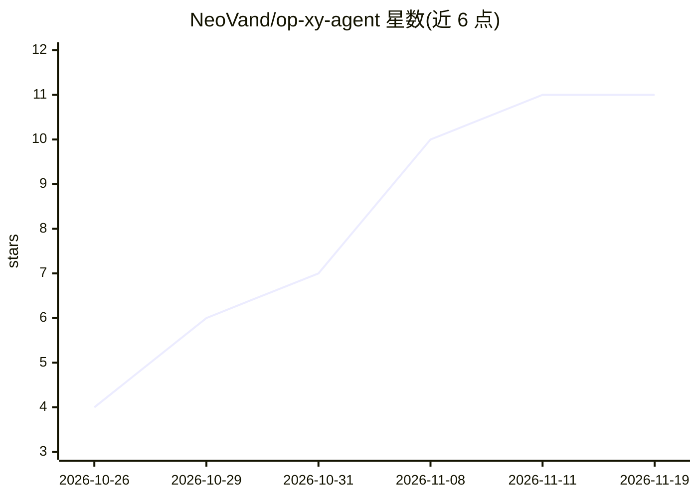

# NeoVand/op-xy-agent

⭐ 11 · TypeScript · MIT · 推送 2026-10-05 · [GitHub](https://github.com/NeoVand/op-xy-agent) · [官网](https://neovand.github.io/op-xy-agent/) · 个人维护

**给 OP-XY 用户：可玩的浏览器复刻加读手册、能编程真机的 AI agent**

浏览器端应用，包含 Teenage Engineering OP-XY 的像素级可演奏复刻（8 个合成引擎按真机录音校准、音序器、采样器、WAV/MIDI 导出），以及一个 AI agent：基于自编 166 单元手册回答问题并给出具体按键操作，可代写 pattern/歌曲/音色，经 Web MIDI/USB 驱动真机并支持 MTP 项目传输。无服务器、纯静态文件，API key 由用户自带；预览版仍在开发中，安装器未经真机验证。

## 筛选速览

| 维度 | 判定 | 备注 |
|---|---|---|
| AI 角色 | `ai-enhanced` | 去掉 AI 部分产品仍成立 |
| 许可风险 | `permissive` | MIT |
| 部署形态 | `library` | 以包/库形式分发 |
| 模型依赖 | — | README 未给出锁定关系 |
| 硬件要求 | — | 无带数字的原话,不猜 |
| 安装摩擦 | `low` | 无编译、无系统依赖或容器化 |
| 成熟度 | `idea` | |

## 能力要点

- 480×222 像素级屏幕模拟器，音色按真机 USB 音频测量校准
- Agent 基于自编手册作答，事实均标注出处章节
- Web MIDI 镜像与驱动真机，MTP 模式传输项目
- 预设制作器将用户采样转为鼓组/切片/多重采样预设

## 适用场景

- 不买真机也能在浏览器学习和试奏 OP-XY
- 问 "这个功能怎么按" 得到从当前页面出发的逐步按键
- 用自然语言描述音色或节奏让 agent 代写并下发真机
- 把自己的 WAV 采样做成 OP-XY 预设

## 场景标签

`AI 助手` `文档问答` · 领域:对话与助手

## 证据(README 行号)

> L5: A browser app for learning, playing and programming the Teenage Engineering **OP-XY**. It pairs a
> L6: replica of the instrument that you can play with an AI agent that knows the machine inside out. The
> L7: agent teaches it, and it programs it for you. It runs in a desktop browser; a phone gets a preview
> L84: API keys are kept in your browser and sent only to their provider: Anthropic for the agent, and
> L85: OpenAI for voice. There is no server; the app is static files.

## 星数曲线

2026-10-26 4 → 2026-11-19 11（+7）

---
*卡片 v1 · prompt 1.4 · 生成 2026-11-19 · 置信度 high · 依据 README sha `a35e285dd888` · [字段定义](../../DATASET.md)*
