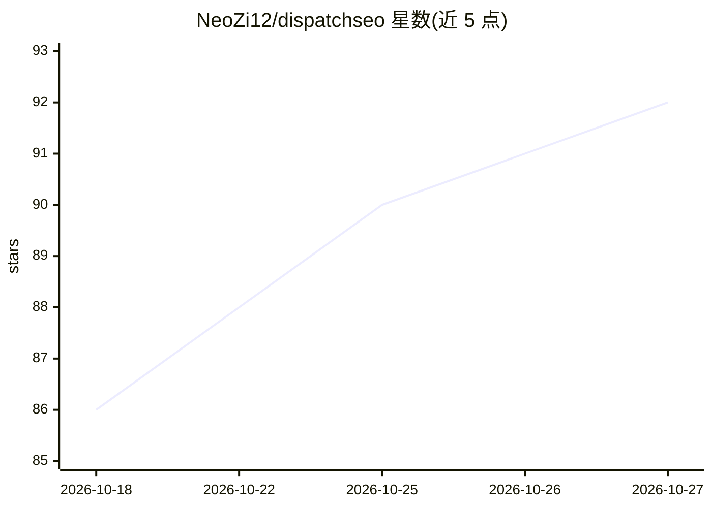

# NeoZi12/dispatchseo

⭐ 92 · TypeScript · AGPL-3.0 · 推送 2026-10-24 · [GitHub](https://github.com/NeoZi12/dispatchseo) · [官网](https://dispatchseo.com) · 个人维护

**让 AI 编码代理接管 SEO 的自托管系统（关键词、内容、排名）**

自托管的 SEO 管理后端，通过 MCP 协议接入 Claude Code、Codex、Cursor 等编码代理或 claude.ai 应用：代理读取其 playbook，从 Google Search Console、Autocomplete 等来源挖掘关键词并进入审批队列；定时任务将批准的想法构建为指向站点仓库的 Pull Request（指南或小工具），并做每日排名检查与索引验证。后端负责状态、调度与审批门，思考部分发生在代理中。自托管需 Docker（约 1GB 内存）、WordPress 或 GitHub 仓库站点及 Search Console 访问权限；免费档可用，付费数据源可选。

## 筛选速览

| 维度 | 判定 | 备注 |
|---|---|---|
| AI 角色 | `ai-ecosystem` | LLM/agent 周边工具 |
| 许可风险 | `viral` | AGPL-3.0 |
| 部署形态 | `library` | 以包/库形式分发 |
| 模型依赖 | — | README 未给出锁定关系 |
| 硬件要求 | — | 无带数字的原话,不猜 |
| 安装摩擦 | `low` | 无编译、无系统依赖或容器化 |
| 成熟度 | — | 结构信号不足 |

## 能力要点

- MCP 服务器提供与仪表盘对等的完整工具集（队列、关键词、排名、GSC 统计、外链等）
- 定时任务将批准的想法构建为站点仓库的 Pull Request，含 SERP 校验与查重审查
- 每日排名检查、每小时 Search Console 快照与索引验证
- 一次部署可管理多站点，各项目独立 MCP token

## 适用场景

- 让我的编码代理自动研究关键词并生成 SEO 内容 PR
- 每天早上自动构建已批准的内容选题并跟踪排名
- 通过仪表盘审批队列控制代理产出的内容方向

## 场景标签

`编码 Agent` `AI 写作` · 领域:编码与开发

## 证据(README 行号)

> L51:  (Claude Code, Codex, Cursor), connects to DispatchSEO over MCP,
> L174: - **MCP server** with the full tool set: the

## 星数曲线

2026-10-18 86 → 2026-10-27 92（+6）

---
*卡片 v1 · prompt 1.4 · 生成 2026-10-23 · 置信度 mid · 依据 README sha `b8ae8cbf8a17` · [字段定义](../../DATASET.md)*
